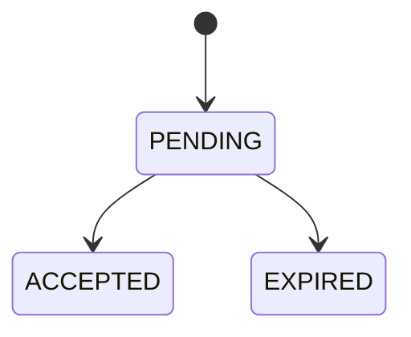
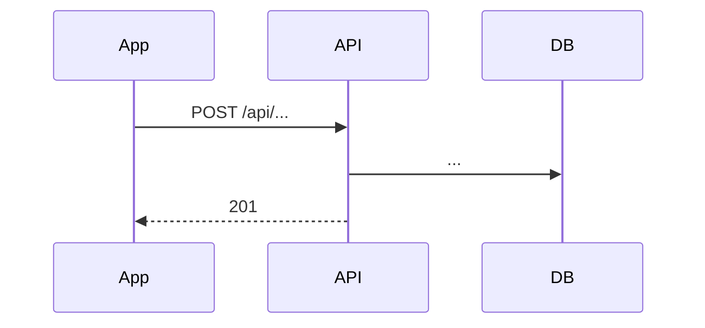

# Módulo `<nombre>`

> Copia este archivo a `docs/modulos/<nombre>.md`, completa cada sección y enlázalo desde el índice (`docs/README.md`). Borra las secciones que no apliquen.

**Código:** `src/<nombre>/`

## Propósito

Qué problema resuelve el módulo, en dos o tres líneas.

## Alcance

**Hace:**
- ...

**No hace:**
- ... (y qué módulo se encarga, si aplica)

## Modelos

| Modelo | Uso en este módulo |
| --- | --- |
| `...` | ... |

## Endpoints

Requieren `Authorization: Bearer <token>` salvo que se indique lo contrario. Los que trabajan sobre un negocio necesitan `x-business-id`.

| Método | Ruta | Rol requerido | Qué hace |
| --- | --- | --- | --- |
| `GET` | `/api/...` | `OWNER`, `ADMIN` | ... |

## Reglas de negocio

- ...

## Estados

Si la entidad tiene estados, cómo pasa de uno a otro:

## Flujos

### <Nombre del flujo>

1. ...
2. ...

## Permisos y seguridad

- ...

## Integraciones

| Con | Para qué |
| --- | --- |
| `audit` | ... |

## Errores

| Código | Cuándo |
| --- | --- |
| 400 | ... |
| 403 | ... |
| 404 | ... |

## Decisiones y pendientes

- **Decisión:** ... **Por qué:** ...
- **Pendiente:** ...
