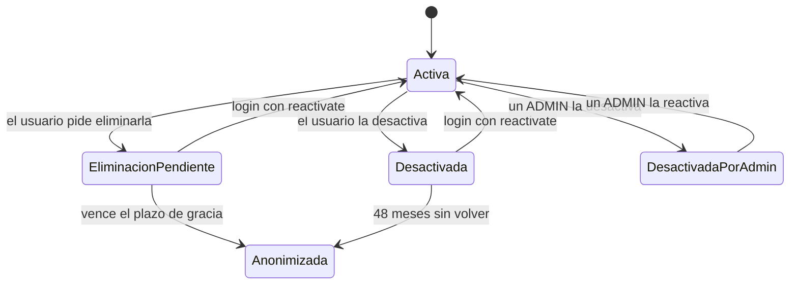

# Módulo `account-lifecycle`

**Código:** `src/account-lifecycle/` · transferencia y exportación en `src/business/` · **Ejecución manual:** `src/maintenance.ts`

## Propósito

Gestionar qué pasa con una cuenta y con sus negocios cuando el usuario se va, se toma una pausa o le pasa el negocio a otra persona. Cumple el derecho de supresión de la **Ley 1581 de 2012** y lo que exigen App Store y Google Play: toda app que permite crear cuentas debe permitir eliminarlas.

## Alcance

**Hace:**
- **Desactivar** la cuenta propia: es una pausa reversible.
- **Eliminar** la cuenta propia: hay 15 días de gracia y después se anonimiza.
- **Desactivar y reactivar** cuentas, si quien lo hace es administrador de la plataforma.
- **Transferir** la propiedad de un negocio a un miembro, que debe aceptarla.
- **Exportar en Excel** la información de un negocio (solo el dueño).
- Correr la **tarea diaria** que aplica los plazos de retención.

**No hace:**
- Reabrir un negocio cerrado: no existe endpoint para eso.
- Recuperar una cuenta anonimizada: la anonimización es definitiva.
- Cerrar un negocio. Eso lo hace `business` (`PATCH /api/business/:id/inactivate`); aquí solo se borran sus datos cuando vence el plazo.

## Estados de la cuenta

| Estado | Código en el login (403) | Cómo se llega | Cómo se sale |
| --- | --- | --- | --- |
| Activa | — | Registro | — |
| Desactivada por el usuario | `ACCOUNT_DEACTIVATED` | `POST /api/users/me/deactivate` | Login con `reactivate: true` |
| Eliminación pendiente | `ACCOUNT_DELETION_PENDING` | `POST /api/users/me/deletion` | Login con `reactivate: true` antes de `deletionScheduledAt` |
| Desactivada por un administrador | `ACCOUNT_DISABLED` | `PATCH /api/users/:id/inactivate` | `PATCH /api/users/:id/reactivate` (solo `ADMIN`) |
| Anonimizada | No puede entrar: sus datos ya no existen | Vence la eliminación o la retención de inactividad | No se sale: es definitivo |



### Desactivar y eliminar no son lo mismo

| | Desactivar | Eliminar |
| --- | --- | --- |
| Para qué | Una pausa: deja de usar la app sin perder nada | Irse: que se borren sus datos personales |
| Sesiones | Se cierran todas | Se cierran todas |
| Datos personales | Se conservan | Se borran al terminar el plazo de gracia |
| Sus negocios | **Siguen activos**, y su equipo sigue trabajando | Se cierran al anonimizar |
| Cómo vuelve | Iniciando sesión, cuando quiera | Iniciando sesión, antes de que venza el plazo |
| Si no vuelve | A los 48 meses se anonimiza | A los 15 días se anonimiza |

Las dos operaciones piden la contraseña actual.

## Modelos

### Campos de `User` del ciclo de vida

| Campo | Tipo | Qué es |
| --- | --- | --- |
| `inactivatedAt` | `DateTime?` | Desde cuándo la cuenta no está activa. `null`: activa |
| `inactivatedBy` | `InactivationSource?` | Quién la desactivó. El usuario solo puede reactivar lo que desactivó él mismo |
| `deletionRequestedAt` | `DateTime?` | Cuándo pidió eliminarla |
| `deletionScheduledAt` | `DateTime?` | Cuándo se anonimizará si no la cancela |
| `anonymizedAt` | `DateTime?` | Cuándo se borraron sus datos personales. Es definitivo |

Enum `InactivationSource`:

| Valor | Significado |
| --- | --- |
| `SELF` | La desactivó el propio usuario |
| `ADMIN` | La desactivó un administrador de la plataforma |

La migración `20261020004606_account_lifecycle` marca como `ADMIN` las cuentas que ya estaban inactivas, porque antes solo un administrador las desactivaba. Esas cuentas no pueden reactivarse solas.

### `UserConsent.revokedAt`

Cuándo el usuario retiró la autorización de tratamiento de datos: se llena al anonimizar. La fila de la aceptación se conserva como prueba de lo que aceptó mientras tuvo cuenta.

### `BusinessOwnershipTransfer`

Propuesta del dueño de pasarle el negocio a un miembro. Solo puede haber una vigente por negocio.

| Campo | Tipo | Qué es |
| --- | --- | --- |
| `id` | `String` (UUID), PK | |
| `businessId` | `String`, FK → `Business` | El negocio |
| `fromUserId` | `String`, FK → `User` | El dueño que la propone |
| `toUserId` | `String`, FK → `User` | El miembro que la recibe |
| `status` | `OwnershipTransferStatus` | Estado. Por defecto `PENDING` |
| `expiresAt` | `DateTime` | Plazo para responder: 7 días desde la propuesta |
| `respondedAt` | `DateTime?` | Cuándo dejó de estar pendiente |
| `createdAt` | `DateTime` | |

Índices: `[businessId, status]` y `[toUserId, status]`.

Enum `OwnershipTransferStatus`:

| Valor | Cuándo |
| --- | --- |
| `PENDING` | Recién propuesta, sin respuesta |
| `ACCEPTED` | El miembro aceptó y ya es el dueño |
| `REJECTED` | El miembro la rechazó |
| `CANCELLED` | La canceló el dueño, sacaron al miembro del equipo, el negocio se cerró, cambió de dueño o se anonimizó una de las dos cuentas |
| `EXPIRED` | Pasaron los 7 días sin respuesta |

## Endpoints

Todos requieren `Authorization: Bearer <token>`. Ninguno usa `x-business-id`: la propiedad del negocio se comprueba con el id de la ruta.

### Cuenta propia (`users`)

| Método | Ruta | Body | Qué hace |
| --- | --- | --- | --- |
| `POST` | `/api/users/me/deactivate` | `{ password }` | Desactiva la cuenta y cierra todas sus sesiones |
| `GET` | `/api/users/me/deletion-preview` | — | Devuelve los días de gracia y los negocios activos de los que es dueño, con clientes, saldo por cobrar, candidatos a recibirlo, transferencia pendiente y fecha de la última exportación |
| `POST` | `/api/users/me/deletion` | `{ password, acknowledgeBusinessClosure? }` | Programa la eliminación y cierra todas sus sesiones |

### Administración (`users`, solo `ADMIN`)

| Método | Ruta | Qué hace |
| --- | --- | --- |
| `PATCH` | `/api/users/:id/inactivate` | Desactiva la cuenta y detiene una eliminación pendiente: la cuenta queda bajo control del administrador |
| `PATCH` | `/api/users/:id/reactivate` | Reactiva la cuenta. No sirve si el usuario pidió eliminarla: solo él puede cancelarlo |

### Login (`auth`)

`POST /api/auth/login` con `reactivate: true` reactiva una cuenta `SELF` y cancela una eliminación pendiente. El estado de la cuenta solo se revela **después** de comprobar la contraseña, para no decirle a un tercero si una cuenta existe o está desactivada.

### Transferencia (`business`)

| Método | Ruta | Quién | Qué hace |
| --- | --- | --- | --- |
| `POST` | `/api/business/:id/ownership-transfer` | Dueño | Body `{ toUserId, password }`. Propone la transferencia a un miembro activo |
| `GET` | `/api/business/:id/ownership-transfer` | Dueño o destinatario | Devuelve la transferencia vigente, o `null` |
| `DELETE` | `/api/business/:id/ownership-transfer` | Dueño | Cancela la transferencia vigente |
| `GET` | `/api/business/ownership-transfers/incoming` | Cualquiera | Devuelve las transferencias que el usuario tiene por responder |
| `POST` | `/api/business/ownership-transfers/:transferId/accept` | Destinatario | Acepta: pasa a ser dueño y el anterior queda como `ADMIN` |
| `POST` | `/api/business/ownership-transfers/:transferId/reject` | Destinatario | Rechaza |

### Exportación (`business`)

| Método | Ruta | Quién | Qué hace |
| --- | --- | --- | --- |
| `GET` | `/api/business/:id/export` | Dueño | Descarga un `.xlsx` con las hojas Resumen, Clientes, Deudas y Pagos. El archivo se llama `appuntao-<negocio>-<fecha>.xlsx`. Funciona también con el negocio cerrado. Cada descarga queda en auditoría (`BUSINESS_DATA_EXPORTED`) |

## Reglas de negocio

### Eliminar la cuenta

- Si es dueño de negocios activos, tiene que confirmar con `acknowledgeBusinessClosure: true` que entiende que se cerrarán. Si no lo envía, recibe 400 `BUSINESS_CLOSURE_ACK_REQUIRED` con la lista de negocios. Tener negocios **nunca** impide eliminar la cuenta.
- Durante el plazo de gracia, el miembro al que le propuso un negocio todavía puede aceptarlo: es justo el caso de quien lo pasa antes de irse.

### Qué hace la anonimización

| Dato | Qué pasa |
| --- | --- |
| Nombre y apellido | Pasan a ser "Usuario eliminado" |
| Correo, celular y contraseña | Se borran |
| Documento | Se reemplaza por `deleted-<id>`, así el documento real queda libre para un registro futuro |
| Sesiones (refresh tokens) | Se borran |
| Vínculo como cliente (`Debtor.userId`) | Se rompe. **El registro del cliente se conserva**, porque es del negocio: sus deudas y pagos siguen ahí |
| Aceptaciones legales | Se conservan, marcadas con `revokedAt` |
| Membresías en negocios ajenos | Se borran |
| Sus negocios | Se cierran (`inactivatedAt`), y sus datos se borran 6 meses después |
| Transferencias pendientes, enviadas o recibidas | Se cancelan |

### Logs de seguridad (`AuthLog`)

**La anonimización no borra los registros de seguridad.** Cada intento de login guarda el identificador que se escribió (correo, celular o documento), la IP, el navegador o la app y el dispositivo, y eso se conserva después de eliminar la cuenta.

Es una decisión: sirve para investigar accesos indebidos y para probar lo que pasó con una cuenta. Pero es tratamiento de datos personales después de la supresión, así que **la Política de Tratamiento de Datos Personales tiene que decirlo**: qué se conserva, para qué y por cuánto tiempo. Hoy no hay un plazo de borrado para `AuthLog`. Queda pendiente definirlo y agregarlo a la tarea diaria.

### Transferencia

- Solo el dueño la propone, confirmando con su contraseña, y solo a un miembro activo del negocio.
- Hay una sola vigente por negocio. Para proponer otra, primero se cancela la que hay; si no, la respuesta es 409.
- Al aceptar, el negocio cambia de dueño en una transacción: el nuevo queda `OWNER` y el anterior `ADMIN`.
- Si al aceptar el negocio ya no está activo, cambió de dueño o el destinatario ya no es miembro, la transferencia se cancela y se responde 400.
- Sacar a un miembro del equipo cancela las transferencias que tenía por responder.
- El nuevo dueño tendrá pendiente el acuerdo de transmisión de datos para negocios (ver [legal](legal.md)), y la app se lo pide al aceptar.

### Exportar antes de cerrar

**Un negocio cerrado deja de aparecer en `GET /api/business`**, porque la guardia de negocio ya rechaza cualquier operación sobre él. Por eso la app ofrece la descarga **antes** de cerrarlo y en la pantalla de eliminar la cuenta, no después.

El endpoint sí funciona con el negocio cerrado: un dueño que tenga el id puede descargarlo hasta que se borre. `deletion-preview` devuelve `lastExportedAt` para que la app pueda decir "lo descargaste el…".

Cerrar un negocio (`PATCH /api/business/:id/inactivate`) devuelve `dataDeletionScheduledAt`: la fecha en que se borrarán sus datos.

## Tarea diaria

`AccountMaintenanceService` corre **todos los días a las 3:00 a. m., hora de Colombia**, y en este orden:

1. Anonimiza las cuentas cuya eliminación venció.
2. Anonimiza las cuentas desactivadas hace más de `INACTIVE_ACCOUNT_RETENTION_MONTHS`.
3. Marca como vencidas (`EXPIRED`) las transferencias sin respuesta.
4. Borra los datos de los negocios cerrados hace más de `CLOSED_BUSINESS_RETENTION_MONTHS`: clientes, deudas, pagos, invitaciones, miembros, transferencias y su auditoría, porque esa auditoría guarda datos de los clientes. Solo quedan el registro de las exportaciones y el de la eliminación (`BUSINESS_PURGED`).

| Variable (opcional) | Por defecto | Qué es |
| --- | --- | --- |
| `ACCOUNT_DELETION_GRACE_DAYS` | 15 | Días entre la solicitud y la anonimización. Debe caber en los 15 días hábiles que da la ley para atender el reclamo |
| `INACTIVE_ACCOUNT_RETENTION_MONTHS` | 48 | Meses que se conserva una cuenta desactivada |
| `CLOSED_BUSINESS_RETENTION_MONTHS` | 6 | Meses que se conservan los datos de un negocio cerrado |

Para ejecutarla a mano, por ejemplo si el servidor estuvo caído a esa hora:

```bash
npm run build
npm run maintenance:run:local   # o :development / :production
```

- **En Render** corre porque el servidor no se duerme: un monitor llama `/api/health` cada 5 minutos. Si se quita el monitor, el plan gratuito duerme el servidor y la tarea deja de correr.
- **Es idempotente:** cada cuenta y cada negocio se procesa una sola vez, aunque haya varias instancias.
- **Primer despliegue en un entorno:** la primera ejecución actúa de inmediato sobre todo lo que ya cumpla los plazos. Antes de desplegar, cuenta cuántos registros hay en esa situación. El 2026-11-10, development no tenía ninguno.

## Errores

| Código | `error` | Cuándo |
| --- | --- | --- |
| 400 | — | Contraseña incorrecta; destinatario que no es miembro activo; transferencia vencida; negocio inactivo o con otro dueño al aceptar |
| 400 | `BUSINESS_CLOSURE_ACK_REQUIRED` | Pidió eliminar su cuenta siendo dueño de negocios sin confirmar el cierre. Trae `ownedBusinesses` |
| 403 | `ACCOUNT_DEACTIVATED` | Login de una cuenta que el usuario desactivó |
| 403 | `ACCOUNT_DELETION_PENDING` | Login de una cuenta con eliminación pendiente. Trae `deletionScheduledAt` |
| 403 | `ACCOUNT_DISABLED` | Login de una cuenta desactivada por un administrador |
| 403 | — | No es el dueño del negocio, o no es `ADMIN` |
| 404 | — | Transferencia o negocio no encontrados |
| 409 | — | Ya hay una transferencia pendiente, o ya fue respondida |

La app decide según `error`, nunca según el texto de `message`.

## Integraciones

| Con | Para qué |
| --- | --- |
| `auth` | El login revisa el estado de la cuenta y reactiva |
| `auth-log` | Eventos `ACCOUNT_DEACTIVATED`, `ACCOUNT_REACTIVATED`, `ACCOUNT_DELETION_REQUESTED`, `ACCOUNT_DELETION_CANCELLED`, `ACCOUNT_ANONYMIZED` |
| `audit` | Eventos de transferencia, `BUSINESS_DATA_EXPORTED` y `BUSINESS_PURGED` |
| `legal` | Marca las aceptaciones como revocadas al anonimizar; el nuevo dueño acepta el acuerdo para negocios |
| `business-user` | Sacar a un miembro cancela sus transferencias pendientes |

## Decisiones y pendientes

- **Decisión:** eliminar no es inmediato, sino que deja 15 días de gracia. **Por qué:** una eliminación por error no tiene arreglo, y la ley da 15 días hábiles para atender la solicitud.
- **Decisión:** la anonimización conserva los datos de los negocios donde la persona era cliente. **Por qué:** son del negocio, que es el Responsable de esos datos, y no del usuario que se va.
- **Decisión:** la transferencia necesita que el destinatario acepte. **Por qué:** ser dueño implica responder por el negocio y por los datos de sus clientes.
- **Pendiente:** fijar un plazo de retención para `AuthLog` y anunciarlo en la política de datos.
- **Pendiente:** Google Play pide además una **página web** donde se explique cómo pedir la eliminación sin la app.
