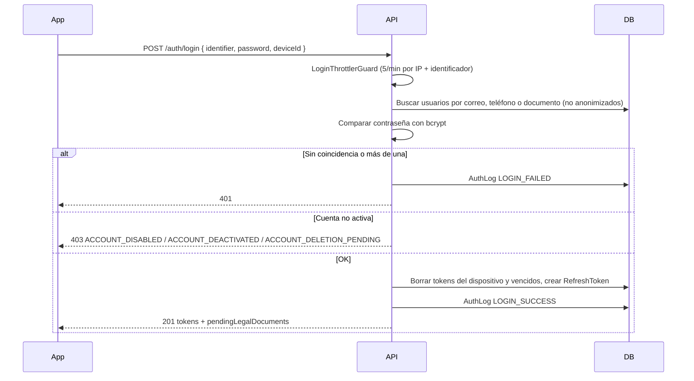

# Módulo `auth`

**Código:** `src/auth/`

## Propósito

Autentica a los usuarios y mantiene sus sesiones: emite el access token (JWT) y el refresh token, los renueva con rotación y cierra sesiones por dispositivo o en todos. También aporta los guards y decorators de autorización que usa el resto de módulos.

## Alcance

**Hace:**
- Login con correo, teléfono o número de documento.
- Una sesión por dispositivo, con refresh token rotativo y detección de reutilización.
- Logout del dispositivo actual o de todos.
- Bloqueo temporal tras varios intentos fallidos de login.
- Reactivar la cuenta desde el login, si la desactivó el propio usuario.
- Devolver en login y refresh los documentos legales pendientes de aceptar.
- Guards y decorators de autorización (ver [arquitectura.md](../arquitectura.md#autenticación-y-autorización)).

**No hace:**
- Registro de usuarios ni cambio de contraseña: está en [`users`](users.md).
- Desactivar o eliminar cuentas: está en `account-lifecycle` ([account-lifecycle.md](account-lifecycle.md)).
- Guardar los eventos de seguridad: lo hace `auth-log`, al que este módulo le reporta.
- Recuperar la contraseña olvidada: todavía no existe.

## Modelos

| Modelo | Uso en este módulo |
| --- | --- |
| `User` | Credenciales, rol de plataforma y estado de la cuenta |
| `RefreshToken` | Sesiones: hash del token, familia, dispositivo, vencimiento y rotación |
| `AuthLog` | Eventos de seguridad (a través de `AuthLogService`) |

## Endpoints

Ninguno exige access token.

| Método | Ruta | Entrada | Qué hace |
| --- | --- | --- | --- |
| `POST` | `/api/auth/login` | Body: `identifier`, `password`, `deviceId`, `deviceName?`, `reactivate?` | Inicia sesión. Límite: 5 intentos por minuto por IP + identificador |
| `POST` | `/api/auth/refresh` | Headers: `x-refresh-token`, `x-device-id?` | Entrega tokens nuevos e invalida el refresh token usado |
| `POST` | `/api/auth/logout` | Header: `x-refresh-token`. Body: `allDevices?` | Cierra la sesión del dispositivo o, con `allDevices: true`, todas |

Login y refresh responden lo mismo:

```json
{
  "user": { "id": "...", "firstName": "...", "role": "USER", "...": "..." },
  "accessToken": "eyJ...",
  "accessTokenExpiresIn": "1d",
  "refreshToken": "<userId>.<token>",
  "refreshTokenExpiresAt": "2026-12-08T00:00:00.000Z",
  "pendingLegalDocuments": [{ "id": "...", "type": "PRIVACY_POLICY", "version": "2026-10" }]
}
```

## Tokens y sesiones

| | Access token | Refresh token |
| --- | --- | --- |
| Formato | JWT firmado con `JWT_SECRET`; payload `{ sub, role }` | `<userId>.<128 caracteres hex aleatorios>` |
| Dónde se guarda en el servidor | No se guarda | Solo el **hash SHA-256** de la parte aleatoria, en `RefreshToken` |
| Duración | `JWT_EXPIRES_IN` (por defecto `1d`) | `REFRESH_TOKEN_EXPIRES_DAYS` (por defecto 30 días) |
| Cómo se envía | `Authorization: Bearer <token>` | Header `x-refresh-token` |

- **Una sesión por dispositivo.** El cliente genera un `deviceId` (UUID) la primera vez y lo envía siempre igual. Al hacer login se borran los refresh tokens anteriores de ese dispositivo y los vencidos del usuario.
- **Familia.** Cada login abre una familia (`familyId`). Las rotaciones de esa sesión pertenecen a la misma familia, y cerrar la sesión borra la familia completa.
- **El usuario se lee de la base en cada petición.** `JwtStrategy` no confía en el payload: busca al usuario por `sub` y, si está inactivado, responde 401. Por eso desactivar una cuenta corta el acceso de inmediato, aunque su access token no haya vencido, y `RolesGuard` usa el rol actual de la base, no el del token.

## Flujos

### Login



1. El `identifier` se normaliza: `"Juan@Correo.com"`, `"+57 300 123 4567"` o `"1.032.876.361"` encuentran lo guardado como `juan@correo.com`, `3001234567` o `1032876361`.
2. Si la contraseña coincide con **más de una** cuenta (por ejemplo, el documento de una es el teléfono de otra), se rechaza y se pide entrar con otro dato.
3. El estado de la cuenta se revisa **después** de validar la contraseña, para no revelar el estado de una cuenta a quien no es su dueño:
   - `ACCOUNT_DISABLED`: la desactivó un administrador. No se puede reactivar desde el login.
   - `ACCOUNT_DEACTIVATED` o `ACCOUNT_DELETION_PENDING`: la desactivó el propio usuario. Si repite el login con `reactivate: true`, la cuenta se reactiva y se cancela la eliminación pendiente.
4. Si `pendingLegalDocuments` no viene vacío, el frontend debe mostrar esos documentos y registrar la aceptación (ver [legal.md](legal.md)).

### Refresh (rotación)

1. Se busca el token por su hash y se comprueba que pertenezca al `userId` del prefijo.
2. Se rechaza con 401 si no existe, venció o el `x-device-id` enviado no coincide con el del token.
3. **Si el token ya fue rotado** (alguien lo reutiliza):
   - dentro de los **30 segundos** siguientes a la rotación: 401 sin cerrar la sesión. Cubre el caso del frontend que lanza dos refresh a la vez con el mismo token;
   - después: se borra **toda la familia**, se registra `REFRESH_TOKEN_REUSED` y se responde 401 ("La sesión se cerró por seguridad"). Se asume que el token fue robado.
4. Si el usuario está inactivado: 401.
5. En una transacción, se marca el token como rotado (solo si nadie lo rotó antes), se borran los rotados anteriores de la familia y se emite uno nuevo en la misma familia.

El cliente **debe guardar el refresh token nuevo** en cada respuesta; el anterior deja de servir.

### Logout

- **Dispositivo actual:** borra la familia del token. Si el token no existe o ya no está activo, responde 200 igual (el resultado es el mismo: no hay sesión).
- **Todos los dispositivos** (`allDevices: true`): exige un token activo y borra todos los refresh tokens del usuario.

Los access tokens ya emitidos siguen siendo válidos hasta que venzan; el logout invalida la posibilidad de renovarlos.

## Permisos y seguridad

- Contraseñas con **bcrypt** (10 rondas). Los refresh tokens nunca se guardan en claro.
- **Límite de login:** 5 intentos por minuto por combinación IP + identificador. Al bloquear se registra un único `LOGIN_BLOCKED` por ventana de bloqueo.
- El contador del límite vive **en memoria** de cada instancia: se reinicia al reiniciar el servidor y no se comparte entre instancias.
- Detrás de un proxy (Render) hay que definir `TRUST_PROXY=1`. Sin eso, todas las peticiones parecen venir de la IP del proxy y el límite se aplica a todos los usuarios a la vez.
- `JWT_SECRET` debe tener al menos 32 caracteres o la aplicación no arranca.

## Eventos que registra en `auth-log`

| Evento | Cuándo |
| --- | --- |
| `LOGIN_SUCCESS` | Login correcto |
| `LOGIN_FAILED` | Credenciales inválidas (`INVALID_CREDENTIALS`), identificador ambiguo (`AMBIGUOUS_IDENTIFIER`) o cuenta no activa (`ACCOUNT_*`) |
| `LOGIN_BLOCKED` | Se superó el límite de intentos |
| `REFRESH_TOKEN_REUSED` | Se reutilizó un refresh token ya rotado (fuera del margen de 30 s) |
| `LOGOUT` / `LOGOUT_ALL_DEVICES` | Cierre de sesión |

## Integraciones

| Con | Para qué |
| --- | --- |
| `auth-log` | Registrar eventos de seguridad |
| `legal` | Calcular `pendingLegalDocuments` |
| `account-lifecycle` | Estado de la cuenta en el login y reactivación |
| `users` | `serializeUser` y `userSafeSelect`, para no devolver la contraseña ni estados internos |

## Errores

| Código | Cuándo |
| --- | --- |
| 400 | Falta `x-refresh-token` en refresh o logout; body inválido |
| 401 | Credenciales inválidas, identificador ambiguo, refresh token inválido, vencido, de otro dispositivo o reutilizado; usuario inactivado |
| 403 | Cuenta no activa: `ACCOUNT_DISABLED`, `ACCOUNT_DEACTIVATED`, `ACCOUNT_DELETION_PENDING` (este último incluye `deletionScheduledAt`) |
| 429 | Demasiados intentos de login |

## Decisiones y pendientes

- **Decisión:** el refresh token lleva el `userId` como prefijo. **Por qué:** permite comprobar que el token pertenece a ese usuario sin depender solo del hash.
- **Decisión:** margen de 30 s para la reutilización. **Por qué:** sin él, dos refresh simultáneos del mismo cliente cerraban la sesión como si fuera un robo.
- **Decisión:** el estado de la cuenta se informa solo con la contraseña correcta. **Por qué:** no revelar si una cuenta existe o está desactivada.
- **Pendiente:** recuperación de contraseña.
- **Pendiente:** si se despliegan varias instancias, mover el almacenamiento del límite de login a un store compartido (por ejemplo Redis).
