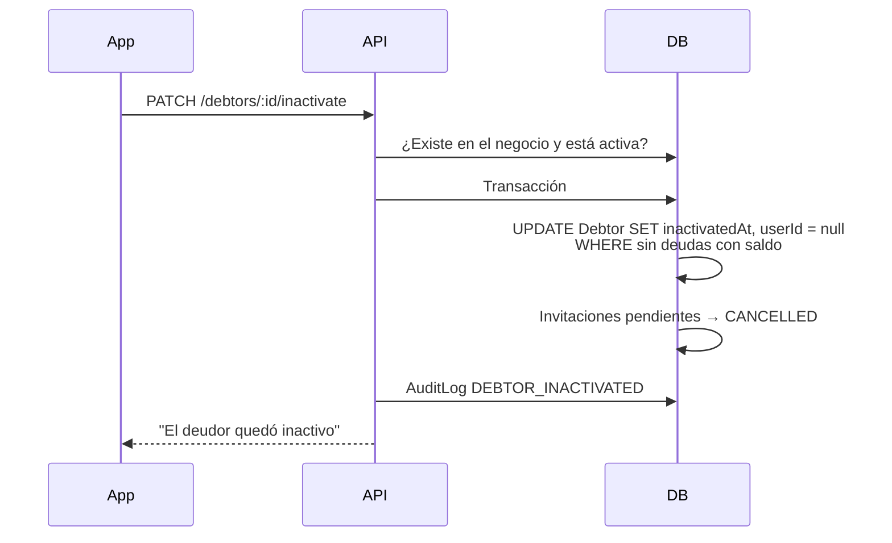

# Módulo `debtors`

**Código:** `src/debtors/`

> **Estado:** revisado en `feature/debtors-review` el 2026-11-22. El backend se probó por script con 53 casos (ver [Qué se verificó](#qué-se-verificó)). La app se ajustó en su rama `feature/debtors-review`; falta probarla en el teléfono.

## Propósito

Los deudores son los **clientes a los que un negocio les fía**. Cada negocio tiene sus propias fichas: la misma persona puede ser cliente de varias tiendas, y cada una tiene su ficha aparte. Una ficha puede estar **vinculada** a una cuenta de usuario; así el cliente ve lo que debe en el modo cliente de la app.

## Alcance

**Hace:**
- Crear, listar, buscar, ver, editar e inactivar fichas de un negocio.
- Calcular el saldo de cada ficha y los totales del negocio (resumen y ranking de los que más deben).
- Listar los clientes de todos los negocios donde trabaja el usuario.
- Modo cliente: mostrarle a la cuenta vinculada sus deudas, y dejar que se desvincule.
- Desvincular una ficha desde el negocio.

**No hace:**
- Vincular una ficha con una cuenta: eso solo pasa al aceptar una invitación (`invitations`).
- Crear deudas ni registrar pagos (`debts`, `payments`).
- Borrar fichas: solo se inactivan. Las borra `account-lifecycle` al purgar un negocio cerrado.

## Modelos

| Modelo | Uso en este módulo |
| --- | --- |
| `Debtor` | La ficha: nombre, celular, tipo y número de documento, notas, negocio, cuenta vinculada (`userId`) e inactivación |
| `Debt` | Se lee para el saldo (`balance` de las deudas `OPEN` y `PARTIAL`) |
| `Invitation` | Al inactivar se cancelan las invitaciones pendientes de la ficha |
| `BusinessUser` | Membresías del usuario, para `GET /debtors/me/all` |
| `AuditLog` | Crear, editar, inactivar y desvincular (a través de `AuditService`) |

## Endpoints

Todos exigen `Authorization: Bearer <token>`. Los del negocio exigen además `x-business-id` y ser miembro de ese negocio activo (`BusinessContextGuard`).

### Lado del negocio

| Método | Ruta | Rol | Qué hace |
| --- | --- | --- | --- |
| `POST` | `/api/debtors` | `OWNER`, `ADMIN`, `CASHIER` | Crear una ficha |
| `GET` | `/api/debtors?page&limit&search&sortBy&order&hasDebt` | Cualquier miembro | Listar las fichas activas, paginadas, con su saldo |
| `GET` | `/api/debtors/summary?top` | Cualquier miembro | Saldo total, conteos y ranking de los que más deben |
| `GET` | `/api/debtors/:id` | Cualquier miembro | Detalle de una ficha activa con todas sus deudas y su saldo |
| `PATCH` | `/api/debtors/:id` | `OWNER`, `ADMIN` | Editar los datos de la ficha |
| `PATCH` | `/api/debtors/:id/inactivate` | `OWNER`, `ADMIN` | Inactivar una ficha sin saldo |
| `PATCH` | `/api/debtors/:id/unlink` | `OWNER`, `ADMIN` | Desvincular la ficha de la cuenta que la veía |

### Del usuario (sin `x-business-id`)

| Método | Ruta | Qué hace |
| --- | --- | --- |
| `GET` | `/api/debtors/me/all` | Fichas de todos los negocios **activos** donde el usuario es miembro, con cualquier rol. Mismos filtros que el listado |
| `GET` | `/api/debtors/me/:debtorId/debts` | Modo cliente: las deudas, con sus pagos y sin paginar, de una ficha vinculada a su cuenta. 404 si no es suya, si está inactiva o si el negocio está cerrado |
| `DELETE` | `/api/debtors/me/:debtorId/link` | Modo cliente: dejar de ver una tienda. 404 si la ficha no es suya |

### Crear y editar: body

| Campo | Reglas |
| --- | --- |
| `name` | Obligatorio al crear, hasta 100 caracteres, se recorta. Al editar no puede quedar vacío ni en `null` |
| `phone` | Opcional. Celular (`3XXXXXXXXX`) o fijo (`60XXXXXXXX`) de Colombia; se guarda con 10 dígitos, sin `+57` ni espacios |
| `documentType` | Opcional: `CC`, `NIT` o `FOREIGNER` |
| `documentNumber` | Opcional. Se valida y normaliza según el tipo: cédula de 6 a 10 dígitos, NIT de 9 o 10, extranjería de 3 a 20 letras o números. Puntos, espacios y guiones se quitan |
| `notes` | Opcional, hasta 500 caracteres |

Cualquier otro campo (`userId`, `businessId`, `inactivatedAt`…) se rechaza con 400.

Al **editar** se manda solo lo que cambia. Si llega el tipo sin el número, o el número sin el tipo, se valida la pareja como queda guardada: cambiar una cédula de 8 dígitos a `NIT` responde 400.

### Listar: filtros

| Parámetro | Qué hace |
| --- | --- |
| `page`, `limit` | Paginación. `limit` de 1 a 100 (por defecto 10) |
| `search` | Busca en nombre, celular y documento, sin distinguir mayúsculas. Si parece un número (`+57 300 111`, `1.032.876`), también lo busca solo con dígitos |
| `sortBy` | `name`, `createdAt` (por defecto), `updatedAt`, `phone` o `documentNumber`. Otro valor responde 400 |
| `order` | `asc` o `desc` (por defecto) |
| `hasDebt` | `true`: solo con saldo. `false`: solo al día. Sin él: todos |

### Qué se devuelve

Cada ficha del listado, del resumen y del detalle trae:

- `totalBalance`: la suma de los saldos de sus deudas `OPEN` y `PARTIAL`. Se suma en `Decimal` y se convierte a número al final.
- `hasPendingDebt`: `totalBalance > 0`.
- `user`: de la cuenta vinculada, **solo** `id`, `firstName` y `lastName`; `null` si no está vinculada. La app solo lo usa para saber si está vinculada.

El detalle trae además `business` (`id`, `name`) y `debts`: **todas** sus deudas con sus pagos, incluidas las pagadas y canceladas, sin paginar y de la más reciente a la más antigua. Tienen el mismo formato que `GET /debtors/:id/debts` (del módulo `debts`). La app arma con ellas el saldo, los totales y el extracto, así que no pueden venir recortadas.

## Reglas de negocio

- **Sin duplicados dentro del negocio.** No puede haber dos fichas **activas** del mismo negocio con el mismo celular o el mismo documento. Se compara solo lo que viene: una ficha sin documento no choca con otra sin documento. En negocios distintos sí se puede repetir.
- **Un duplicado responde 409** `DEBTOR_DUPLICATE`, con el campo en `errors` (la app lo pinta en el formulario) y el `debtorId` de la ficha que ya existe.
- **Las fichas inactivas no cuentan como duplicado.** No se pueden reactivar, así que la persona se puede volver a registrar en una ficha nueva. La vieja queda con su historial.
- **Inactivar exige saldo cero.** Si alguna deuda `OPEN` o `PARTIAL` tiene saldo, responde 400. La condición va dentro del `UPDATE`, así que una deuda creada al mismo tiempo no deja inactivo a alguien que debe.
- **Al inactivar,** en la misma transacción: se suelta la cuenta vinculada (`userId = null`) y se cancelan las invitaciones pendientes de la ficha.
- **Una ficha inactiva** no aparece en listados, resumen ni modo cliente, y no se puede ver, editar ni volver a inactivar (404).
- **El vínculo con una cuenta** solo se crea al aceptar una invitación (`invitations`). Crear o editar una ficha nunca la vincula, aunque el celular o el documento coincidan con una cuenta.
- **Desvincular** no toca la ficha, sus deudas ni sus pagos. El negocio puede volver a invitar.

## Flujos

### Registrar un cliente

1. El tendero o el cajero llena el formulario (en la app son obligatorios nombre, documento y celular; en la API solo el nombre).
2. Se normalizan el celular y el documento, y se buscan duplicados activos en el negocio.
3. Si no hay, se crea la ficha y queda en auditoría.
4. La app ofrece registrarle una deuda de una vez.

### Inactivar

## Permisos y seguridad

- **Aislamiento por negocio.** Todas las consultas del negocio filtran por el `businessId` del header ya validado. Una ficha de otro negocio responde 404, no 403, para no revelar que existe.
- **Roles.** Crear: dueño, administrador y cajero (registran clientes en el mostrador). Editar, inactivar y desvincular: dueño y administrador. Leer: cualquier miembro, incluido `VIEWER`.
- **Datos de la cuenta vinculada.** El negocio solo ve el nombre. El correo, el teléfono y el documento de la cuenta no se le entregan: el cliente no los compartió al aceptar la invitación (Ley 1581, principio de finalidad).
- **Modo cliente.** Las rutas `me/:debtorId` filtran por `userId` de la ficha; otra cuenta recibe 404.
- **Entrada.** `ValidationPipe` con `whitelist` y `forbidNonWhitelisted`: no se pueden colar campos. `sortBy` y `order` van en lista cerrada.

## Auditoría

| Acción | Cuándo | `meta` |
| --- | --- | --- |
| `DEBTOR_CREATED` | Crear | `debtorId`, `name`, `documentNumber`, `phone`, `businessId` |
| `DEBTOR_UPDATED` | Editar | Antes y después de nombre, tipo y número de documento y celular; `businessId` |
| `DEBTOR_INACTIVATED` | Inactivar | `debtorId`, `businessId`, `previousUserId` (la cuenta que se soltó), `cancelledInvitations` |
| `DEBTOR_UNLINKED` | Desvincular | `businessId`, `previousUserId`, `by` (`BUSINESS` o `CLIENT`) |

## Errores

| Código | Cuándo |
| --- | --- |
| 400 | Datos inválidos; campos no permitidos; `sortBy` u `order` fuera de la lista; `top` fuera de 0 a 50; nombre vacío al editar; inactivar con saldo |
| 403 | No es miembro del negocio, o su rol no alcanza |
| 404 | Ficha inexistente, de otro negocio o inactiva; en modo cliente, ficha que no es suya |
| 409 | `DEBTOR_DUPLICATE` al crear o editar; desvincular una ficha que no estaba vinculada |

## Decisiones y pendientes

- **Decisión (2026-11-22):** los duplicados se buscan solo entre fichas activas. **Por qué:** no hay reactivación, y antes una persona inactivada no se podía volver a registrar nunca.
- **Decisión (2026-11-22):** inactivar suelta la cuenta vinculada. **Por qué:** la ficha inactiva ya no se le mostraba al cliente, pero seguía contando como "ya eres cliente de este negocio" y bloqueaba invitarlo desde una ficha nueva.
- **Decisión (2026-11-22):** el celular no se repite entre clientes activos de un negocio, igual que el documento. **Por qué:** cada persona tiene su propio celular, y es el dato con el que se le cobra y se le invita.
- **Decisión (2026-11-22):** inactivar lo hace el tendero (dueño o administrador) desde la app, no un backoffice. **Por qué:** la lista de clientes es de cada tienda, que es la responsable de esos datos. Sirve para fichas duplicadas por error y clientes que ya no compran.
- **Decisión (2026-11-22):** el negocio solo ve el nombre de la cuenta vinculada. **Por qué:** recibía correo, teléfono, documento y rol global, y la app no los usa.
- **Pendiente (módulo `debts`):** `POST /debts` no revisa si la ficha está inactiva, así que se le puede crear una deuda a una ficha inactiva, que ya no aparece en ningún listado.
- **Pendiente:** no hay índice único en la base para celular o documento por negocio; dos creaciones exactamente simultáneas podrían pasar las dos. Un índice único parcial (`WHERE "inactivatedAt" IS NULL`) lo cerraría, pero antes hay que revisar si development tiene duplicados.

### En la app

Rama `feature/debtors-review` desde `dev`:

- El detalle del cliente usa solo `GET /debtors/:id` (`debtorApi.getDetail`) y ya no `/debtors/:id/debts` (punto 15).
- El validador de celular acepta el indicativo (`+57 300 123 4567`), como el backend.
- Se corrigieron comentarios desactualizados: la columna `searchText` (no existe), el tope de `top` (el backend sí lo valida) y "el detalle no trae saldo".
- Ya estaban bien: la tabla de permisos (`permissions.ts`) coincide con los `@BusinessRoles`, el listado y los contadores usan el resumen del servidor, y los formularios pintan el 409 `DEBTOR_DUPLICATE` en el campo, porque leen `errors`.
- **Quitar cliente** (`PATCH /debtors/:id/inactivate`), al final de la pantalla de editar, que solo abren el dueño y el administrador. Si el cliente debe algo, avisa y no llama al backend; si no, pide confirmación, explica que no se puede deshacer y vuelve a la lista. En la app se llama "quitar" y no "inactivar".

### Puntos de la revisión del 2026-11-22

| # | Punto | Resultado |
| --- | --- | --- |
| 1 | La búsqueda de duplicados le pasaba `undefined` a Prisma dentro del `OR` cuando faltaba el celular o el documento | **Funcionaba** (se probó contra el código anterior: crea bien sin esos datos). Se reescribió para armar el `OR` solo con los campos que vienen |
| 2 | El duplicado respondía 400 y la app esperaba 409 para marcar el campo; además siempre decía "documento" aunque fuera el celular | **Corregido**: 409 `DEBTOR_DUPLICATE` con el campo en `errors` |
| 3 | Editar no buscaba duplicados: se podía poner el celular o el documento de otra ficha | **Corregido** |
| 4 | Una persona inactivada no se podía volver a registrar, y no hay reactivación | **Corregido**: los inactivos no cuentan como duplicado |
| 5 | Al editar solo el número o solo el tipo, el número no se validaba con su tipo | **Corregido**: se valida la pareja final |
| 6 | `name: null` al editar respondía 500 | **Corregido**: 400 |
| 7 | `sortBy` u `order` con cualquier valor respondían 500 | **Corregido**: lista cerrada, 400 |
| 8 | El negocio recibía el correo, teléfono, documento y rol global de la cuenta vinculada | **Corregido**: solo el nombre |
| 9 | Inactivar no soltaba la cuenta ni cancelaba invitaciones, y podía dejar inactivo a alguien con una deuda recién creada | **Corregido**: transacción con condición en el `UPDATE` |
| 10 | El detalle no traía saldo (la app tuvo que dejarlo en `undefined`) | **Corregido**: trae `totalBalance` y `hasPendingDebt` |
| 15 | La app armaba el detalle con `GET /debtors/:id/debts`, que pagina de 10 en 10, y no mandaba `limit`: con más de 10 deudas, el saldo, los totales y el extracto salían incompletos | **Corregido**: el detalle trae todas las deudas con sus pagos y la app usa solo esa petición |
| 11 | Los saldos se sumaban en coma flotante (0,1 + 0,2 = 0,30000000000000004) | **Corregido**: se suman en `Decimal` |
| 12 | `me/all` incluía fichas de negocios cerrados | **Corregido** |
| 13 | Buscar "+57 300 111" o "1.032.876" no encontraba nada, porque se guardan solo dígitos | **Corregido** |
| 14 | `notes` no tenía tope | **Corregido**: 500 caracteres |

### Qué se verificó

Script por HTTP contra una base desechable con las 19 migraciones aplicadas. El código nuevo pasa los 53 casos. Los primeros 50 se corrieron también contra `develop` (f1ede46), que falla 22: son los puntos 2 a 14 de la tabla anterior.

- **Crear:** normaliza celular y documento; crea sin celular ni documento con otras fichas en el negocio; celular y documento duplicados responden 409 con el campo; el mismo celular en otro negocio sí pasa; notas de más de 500, `userId` en el body y un no miembro se rechazan.
- **Listar:** `sortBy` y `order` inválidos responden 400; ordena por nombre; encuentra el celular con `+57` y espacios y la cédula con puntos; `hasDebt` en `true` y `false`; saldo exacto con decimales; de la cuenta vinculada solo llega el nombre.
- **Detalle y resumen:** saldo, deudas y aislamiento entre negocios; con 12 deudas el detalle trae las 12 con sus pagos y el saldo completo, mientras `/debtors/:id/debts` sin `limit` trae 10; ranking sin datos de la cuenta; `top` mayor a 50 responde 400; `me/all` no muestra negocios cerrados.
- **Editar:** el cajero recibe 403; celular y documento de otra ficha responden 409; reenviar su propio celular no es duplicado; `name: null` responde 400; el número se valida con el tipo guardado y el tipo nuevo con el número guardado.
- **Inactivar:** con saldo responde 400; el cajero recibe 403; sin saldo inactiva, suelta la cuenta, cancela la invitación pendiente y lo audita; la segunda vez responde 404; la persona se puede volver a registrar.
- **Modo cliente:** el cliente ve sus deudas y otra cuenta recibe 404; desvincular desde el negocio y desde el cliente, y la segunda vez 409 y 404.
