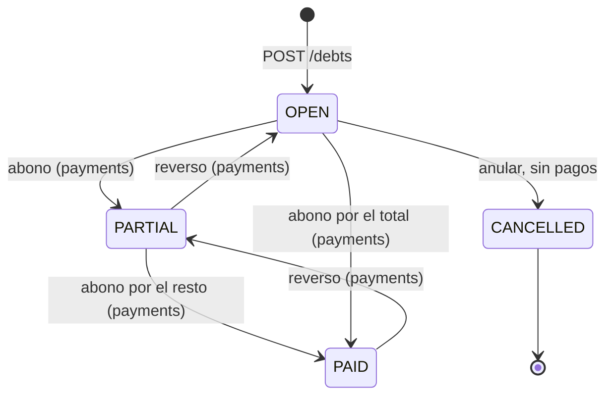
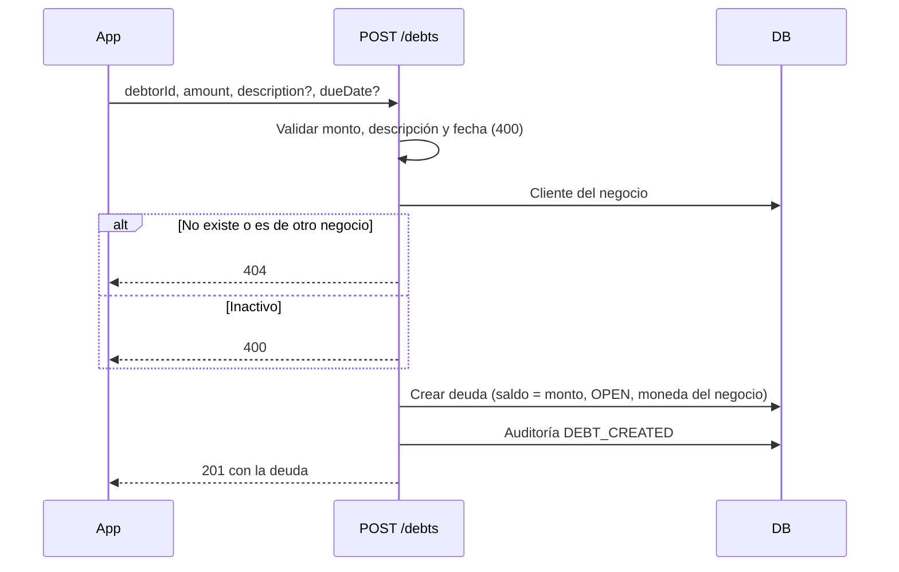

# Módulo `debts`

**Código:** `src/debts/`

> **Estado:** revisado en `feature/debts-review` el 2026-11-22. El backend se probó por script con 48 casos (ver [Qué se verificó](#qué-se-verificó)). La app se ajustó en su rama `feature/debts-review`; falta probarla en el teléfono.

## Propósito

Una deuda es **lo que se le fía a un cliente en una compra**: un monto, una descripción opcional y, si se quiere, una fecha de vencimiento. El saldo de la deuda baja con los pagos y de ahí sale su estado. El saldo de un cliente es la suma de sus deudas abiertas.

## Alcance

**Hace:**
- Crear deudas (fiar) a un cliente activo del negocio.
- Listar las deudas del negocio o de un cliente, con filtros, búsqueda y paginación.
- Anular una deuda registrada por error.

**No hace:**
- Registrar pagos ni recalcular el saldo: eso es `payments` (`recalculateDebtBalance`), que también pone `PARTIAL` y `PAID`.
- Editar el monto o la descripción: una deuda mal registrada se anula y se crea de nuevo.
- Borrar deudas: se conservan como historial. Las borra `account-lifecycle` al purgar un negocio cerrado.
- El detalle completo del cliente con todas sus deudas: es `GET /debtors/:id` (módulo `debtors`).

## Modelos

| Modelo | Uso en este módulo |
| --- | --- |
| `Debt` | Monto, saldo (`balance`), moneda, descripción, estado, vencimiento, quién la creó |
| `Debtor` | Se valida que el cliente sea del negocio y esté activo |
| `Business` | De aquí sale la moneda de la deuda |
| `Payment` | Se cuentan para saber si una deuda se puede anular; van embebidos en la respuesta |
| `AuditLog` | Crear y anular (a través de `AuditService`) |

### Estados

| Estado | Significa | Quién lo pone |
| --- | --- | --- |
| `OPEN` | Saldo igual al monto: no se ha abonado nada | Al crear; `payments` si un reverso la devuelve al monto completo |
| `PARTIAL` | Saldo entre cero y el monto | `payments` |
| `PAID` | Saldo en cero | `payments` |
| `CANCELLED` | Anulada: no se cobra ni suma al saldo del cliente. No se puede deshacer | Este módulo, a mano |



## Endpoints

Todos exigen `Authorization: Bearer <token>`, `x-business-id` y ser miembro de ese negocio activo (`BusinessContextGuard`).

| Método | Ruta | Rol | Qué hace |
| --- | --- | --- | --- |
| `POST` | `/api/debts` | `OWNER`, `ADMIN`, `CASHIER` | Fiar: crear una deuda |
| `GET` | `/api/debts?page&limit&search&sortBy&order&status&overdue` | Cualquier miembro | Deudas del negocio, paginadas. Incluye las de clientes quitados (historial) |
| `GET` | `/api/debtors/:debtorId/debts?…` | Cualquier miembro | Deudas de un cliente activo, paginadas. 404 si es de otro negocio o está inactivo |
| `PATCH` | `/api/debts/:id/status` | `OWNER`, `ADMIN` | Anular (`{ "status": "CANCELLED" }`) |

### Crear: body

| Campo | Regla |
| --- | --- |
| `debtorId` | UUID de un cliente **activo** del negocio. Uno de otro negocio responde 404, igual que uno que no existe |
| `amount` | Número mayor que cero, máximo dos decimales y hasta 9.999.999.999,99 (lo que cabe en `Decimal(12, 2)`) |
| `description` | Opcional. Se recorta; vacía queda nula. Máximo 200 caracteres |
| `dueDate` | Opcional. Fecha ISO 8601 (`2026-12-31` o con hora). No puede estar en el pasado; se da un día de margen por zonas horarias y relojes |

La deuda nace con `balance = amount`, estado `OPEN`, la moneda del negocio y `createdBy` del usuario. `balance`, `status` y `currency` no se aceptan en el body.

### Listar: filtros

| Parámetro | Qué hace |
| --- | --- |
| `page`, `limit` | Paginación; `limit` de 1 a 100, 10 por defecto |
| `search` | Busca en la descripción y en el nombre del cliente, sin distinguir mayúsculas |
| `sortBy` | `createdAt` (por defecto), `updatedAt`, `amount`, `balance`, `dueDate` o `status`. Otro valor: 400 |
| `order` | `asc` o `desc` (por defecto). Otro valor: 400 |
| `status` | `OPEN`, `PARTIAL`, `PAID` o `CANCELLED` |
| `overdue` | `true`: solo las que todavía se deben (`OPEN` o `PARTIAL` con saldo) y cuya fecha ya pasó. Se suma a `status` |

El orden desempata por `id`, para que una página no repita ni salte deudas cuando hay fechas iguales.

### Qué se devuelve

Cada deuda trae `amount` y `balance` (texto decimal, como `"15000.5"`), `currency`, `description`, `status`, `dueDate`, fechas, el negocio (`id`, `name`, `currency`), el cliente (`id`, `name`, `phone`), quién la creó (`id`, `firstName`, `lastName`) y sus pagos, del más reciente al más antiguo. Los listados van en `{ data, meta: { total, page, limit, totalPages } }`.

## Reglas de negocio

- **Solo se fía a clientes activos.** Un cliente quitado ya no está en la lista del negocio y su cuenta quedó desvinculada; para fiarle hay que registrarlo de nuevo.
- **El estado sale del saldo.** `PARTIAL` y `PAID` los calcula `payments` al registrar o reversar pagos. A mano solo se puede anular.
- **Anular solo una deuda `OPEN` sin abonos ni descuentos vigentes.** Si tiene, primero se reversan (`POST /payments/:id/reverse`); los ya reversados no cuentan. La anulada no se puede pagar ni reactivar.
- **La anulada conserva su monto y su saldo** como historial, pero no suma: los saldos (`debtors`, `account-lifecycle`) solo cuentan `OPEN` y `PARTIAL`.
- **Pago y anulación no se cruzan.** Anular toma el mismo bloqueo de fila (`SELECT … FOR UPDATE`) que `payments` al registrar un pago, así que uno espera al otro.
- **La moneda es la del negocio** al momento de fiar.
- **No se fía en un negocio que se está cerrando.** Fiar toma el negocio con `FOR SHARE` y cerrarlo con `FOR UPDATE` (ver [business](business.md)): ya cerrado, responde 400. La deuda y su auditoría van en la misma transacción.

## Flujos

### Fiar



### Anular

```mermaid
sequenceDiagram
    participant App
    participant API as PATCH /debts/:id/status
    participant DB
    App->>API: { status: CANCELLED }
    API->>API: Rol dueño o administrador (403)
    API->>DB: BEGIN; bloquear la fila de la deuda
    API->>DB: Deuda del negocio y número de pagos
    alt No existe o es de otro negocio
        API-->>App: 404
    else Ya anulada, con pagos o no está OPEN
        API-->>App: 400
    end
    API->>DB: status = CANCELLED; COMMIT
    API->>DB: Auditoría DEBT_CANCELLED
    API-->>App: 200 con la deuda
```

## Permisos y seguridad

- **Aislamiento por negocio.** Todo filtra por el `businessId` del header ya validado. Una deuda o un cliente de otro negocio responde 404, sin confirmar que existe.
- **Roles.** Fiar: dueño, administrador y cajero (fían en el mostrador). Anular: dueño y administrador, porque anular es perdonar plata; es la misma regla que reversar un pago global. Leer: cualquier miembro.
- **Entrada.** `ValidationPipe` con `whitelist` y `forbidNonWhitelisted`: no se pueden mandar `balance`, `status` ni `currency` al crear. `sortBy` y `order` van en lista cerrada.

## Auditoría

| Acción | Cuándo | `meta` |
| --- | --- | --- |
| `DEBT_CREATED` | Fiar | `amount`, `debtorId`, `businessId`, `dueDate` |
| `DEBT_CANCELLED` | Anular | `previousStatus`, `newStatus`, `amount`, `balance`, `debtorId`, `businessId` |

En las dos, `userId` es quien hizo la acción. `DEBT_CREATED` se escribe después de crear y es de mejor esfuerzo: si falla, solo queda en la consola. `DEBT_CANCELLED` va **dentro de la transacción** de la anulación (`AuditService.log(params, tx)`): si no se puede escribir, la deuda no se anula. Los intentos rechazados (400, 403, 404) no dejan fila.

`DEBT_STATUS_CHANGED` lo escribe `payments` cuando recalcula el saldo. Para su revisión: su `previousBalance` es el monto original y no el saldo anterior, y se escribe fuera de la transacción del pago.

## Errores

| Código | Cuándo |
| --- | --- |
| 400 | Monto, descripción o fecha inválidos; vencimiento en el pasado (con `errors.dueDate`); campos no permitidos; `sortBy`, `order` u `overdue` inválidos; fiar a un cliente inactivo; anular con un estado distinto de `CANCELLED`, una deuda ya anulada o con abonos o descuentos vigentes |
| 403 | No es miembro del negocio; el cajero intenta anular |
| 404 | Cliente o deuda inexistente o de otro negocio; deudas de un cliente inactivo |

## Decisiones y pendientes

- **Decisión (2026-11-22):** a mano solo se puede anular. **Por qué:** marcar `PAID` o `PARTIAL` sin pago dejaba deudas "pagadas" con saldo y sin ningún registro de quién pagó; además `payments` ya no dejaba abonarles.
- **Decisión (2026-11-22, confirmada con el equipo):** el cajero no anula. **Por qué:** anular borra plata del saldo del cliente sin dejar un pago; queda para el dueño y el administrador, como el reverso de pagos.
- **Decisión (2026-11-22):** solo se anula una deuda sin abonos ni descuentos vigentes. **Por qué:** con abonos, anular escondería plata que sí entró. Primero se reversan; al principio la regla exigía cero pagos y una deuda con un abono ya reversado no se podía anular nunca (se corrigió en la revisión de `payments`).
- **Decisión (2026-11-22):** no se editan deudas. **Por qué:** para el MVP, anular y volver a fiar deja el error y la corrección en el historial.

### En la app

Rama `feature/debts-review` desde `dev`:

- **Anular deuda** en la hoja de detalle de la deuda (`debtApi.cancel`). Solo aparece para el dueño y el administrador y en una deuda `OPEN` sin abonos, lo mismo que exige el backend. Pide confirmación, avisa que no se puede deshacer y recarga el detalle. La anulada muestra "Anulada: no se cobra".
- El permiso `debt:changeStatus` (que incluía al cajero) pasó a `debt:cancel`, solo dueño y administrador.
- Se quitó `debtApi.listByDebtor`, que ya no se usaba: el detalle sale de `GET /debtors/:id` con todas las deudas.
- El aviso de "Quitar cliente" con saldo ya no sugiere anular cualquier deuda, solo las registradas por error.
- Ya estaba bien: fiar manda solo los campos permitidos, la descripción tiene tope de 140, el vencimiento sale de atajos (8, 15, 30 días) que nunca caen en el pasado, y el extracto y los totales no cuentan las anuladas.

### Puntos de la revisión del 2026-11-22

| # | Punto | Resultado |
| --- | --- | --- |
| 1 | Se podía fiar a un cliente inactivo, que ya no aparece en ningún listado | **Corregido**: 400 |
| 2 | Fiar a un cliente de otro negocio respondía 400 "no pertenece al negocio", que confirma que el id existe | **Corregido**: 404 |
| 3 | El monto aceptaba cero, negativos y cualquier número de decimales; uno mayor a `Decimal(12, 2)` respondía 500 | **Corregido**: mayor que cero, dos decimales, con tope |
| 4 | `dueDate` no tenía validación: un texto o una fecha solo con día respondían 500, y se aceptaban fechas pasadas | **Corregido**: fecha válida y no pasada |
| 5 | La descripción no tenía tope ni se recortaba | **Corregido**: 200 caracteres, recortada, vacía queda nula |
| 6 | Toda deuda quedaba en COP aunque el negocio tuviera otra moneda | **Corregido**: toma la del negocio |
| 7 | `PATCH /debts/:id/status` dejaba poner `PAID` o `PARTIAL` sin tocar el saldo | **Corregido**: solo `CANCELLED` |
| 8 | El cajero podía anular deudas | **Cambiado**: solo dueño y administrador |
| 9 | Anular contaba los pagos y luego actualizaba sin bloqueo: un pago simultáneo dejaba la deuda anulada con un pago (se reprodujo 5 de 5 veces) | **Corregido**: el mismo bloqueo de fila que `payments` |
| 10 | Anular se auditaba como `DEBT_STATUS_CHANGED`, igual que el recálculo de `payments`, y después del commit: si la auditoría fallaba, la anulación quedaba sin rastro | **Corregido**: `DEBT_CANCELLED` con monto y saldo, dentro de la transacción |
| 11 | `overdue=false` filtraba como `true` (`@Type(() => Boolean)` convierte cualquier texto en verdadero) | **Corregido** |
| 12 | `overdue` pisaba el filtro `status`, y contaba deudas sin saldo | **Corregido**: se suman con AND y exige saldo |
| 13 | `sortBy` con cualquier valor respondía 500; `order` no se validaba | **Corregido**: lista cerrada, 400 |
| 14 | Sin desempate en el orden, una página podía repetir o saltar deudas | **Corregido**: desempata por `id` |
| 15 | `GET /debtors/:id/debts` de un cliente ajeno o inactivo respondía 200 vacío | **Corregido**: 404, como el detalle |
| 16 | `search` solo buscaba en la descripción | **Ampliado**: también el nombre del cliente |

### Qué se verificó

Script por HTTP contra una base desechable con las 19 migraciones aplicadas. El código nuevo pasa los 48 casos; los primeros 43 se corrieron también contra `develop` (896deac), que pasa 10. Varios fallos de `develop` en la parte de anular son en cadena (la deuda de prueba se creaba con una fecha solo con día, que respondía 500); el punto 7 se ve directo en la tabla de transiciones que se quitó.

- **Crear:** el cajero fía; saldo igual al monto; descripción recortada y vacía nula; moneda del negocio; cliente inactivo 400, de otro negocio e inexistente 404; monto cero, negativo, con tres decimales, gigante o en texto 400; fecha inválida y pasada 400, solo con día pasa; descripción de 201 caracteres y `balance` en el body 400; no miembro 403.
- **Listar:** `overdue` en `true`, `false` y con un valor inválido; `status=PAID` con `overdue` no trae nada; `sortBy` y `order` inválidos 400; ordena por monto; busca por descripción y por nombre del cliente; tres páginas de 2 traen las 5 deudas sin repetir; aislamiento entre negocios; deudas de un cliente, y 404 para uno ajeno o inactivo.
- **Anular:** `PAID` y `PARTIAL` a mano 400; cajero 403; deuda de otro negocio 404; el dueño anula, la segunda vez 400, queda `DEBT_CANCELLED` en la auditoría; no se le puede pagar; con pagos 400; cinco rondas de pago y anulación simultáneos sin ninguna deuda anulada con pagos; el saldo del cliente no cuenta la anulada.
- **Auditoría:** `DEBT_CREATED` con quién fió, monto y vencimiento; una fila por deuda creada y ninguna por intento rechazado; `DEBT_CANCELLED` con quién, estado anterior, monto y saldo; una por cada deuda anulada, también en la carrera; el abono deja `PAYMENT_CREATED`.
