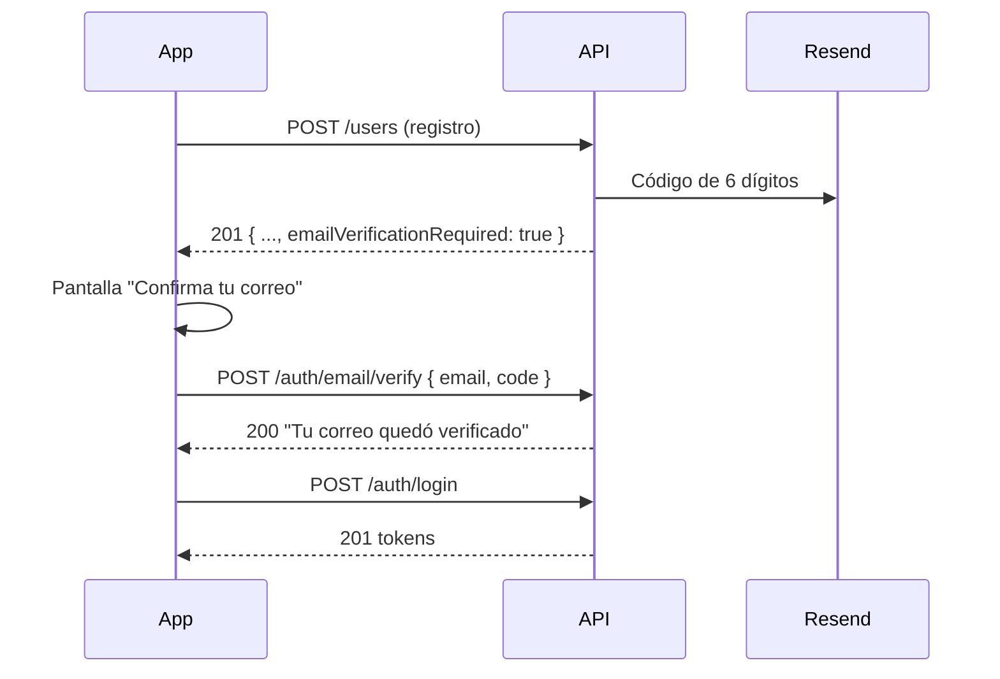

# Módulo `email-verification`

**Código:** `src/email-verification/`

## Propósito

Comprueba que el correo de una cuenta es de quien la creó, con un código de 6 dígitos que llega a ese correo. Sin esto, cualquiera podía registrarse con el correo de otra persona: recibir sus invitaciones y, si la persona real se registraba después, encontrar el correo "ya registrado".

## Cuándo se exige

| Entorno | ¿Se exige? | Cómo se decide |
| --- | --- | --- |
| Production | **Siempre** | `NODE_ENV=production`. La variable no lo puede apagar |
| Development (QA) y local | Solo si `REQUIRE_EMAIL_VERIFICATION=true` | Apagado por defecto: sin un dominio verificado en Resend, los códigos solo le llegan al dueño de la cuenta de Resend |

Lo calcula `account.requireEmailVerification` (`src/config/account.config.ts`). Apagado, el flujo funciona igual (se puede verificar), pero nadie queda bloqueado por no hacerlo.

Al encenderlo en un entorno con cuentas viejas, todas quedan sin verificar: la siguiente vez que entren se les pide el código.

## Alcance

- Enviar el código al registrarse y al intentar entrar sin haber verificado.
- Reenviar el código ("Pedir otro código").
- Verificar el correo con el código.
- **No** verifica el teléfono: eso cuesta (SMS o WhatsApp Business) y queda para después. Por eso las invitaciones exigen su código ([invitations](invitations.md#permisos-y-seguridad)).

## Modelos

| Modelo / campo | Para qué |
| --- | --- |
| `User.emailVerifiedAt` | Cuándo confirmó el correo. `null`: sin verificar. Se vuelve `null` si un administrador le cambia el correo, y al anonimizar la cuenta |
| `EmailVerification` | Cada código enviado: correo al que se envió, HMAC del código (nunca en claro), vencimiento, intentos fallidos, cuándo se usó e IP de quien lo pidió. Se borran a los 7 días |

## Endpoints

Son públicos: quien no ha verificado no puede iniciar sesión, así que no tiene token.

| Método | Ruta | Body | Respuesta |
| --- | --- | --- | --- |
| `POST` | `/api/auth/email/send-code` | `{ email }` | `200 { message }`, exista o no la cuenta |
| `POST` | `/api/auth/email/verify` | `{ email, code }` | `200 { message }` o `400` con el mismo mensaje para todo código inválido |

Además:

| Dónde | Qué cambia |
| --- | --- |
| `POST /api/users` (registro) | Responde `emailVerificationRequired: true` si se exige, y ya envió el código |
| `POST /api/auth/login` | Con la contraseña correcta y el correo sin verificar responde `403 { error: "EMAIL_NOT_VERIFIED", email }` y envía un código |
| `POST /api/auth/refresh` | Una sesión de un correo sin verificar no se renueva (401) |
| `POST /api/auth/password/reset` | Cambiar la contraseña con un código del correo también marca el correo como verificado: ese código ya prueba que es suyo |

## Flujo

Si alguien cierra la app sin verificar, el login responde 403 `EMAIL_NOT_VERIFIED` con el correo y envía un código; la app lleva a la misma pantalla y, al confirmar, vuelve al login.

## Reglas

Las mismas que recuperar la contraseña ([auth](auth.md#recuperar-la-contraseña)), con sus propios contadores:

- El código vence en **15 minutos** y admite **5 intentos** fallidos.
- Uno por minuto y **5 al día** por cuenta. Pedir otro anula el anterior. Por eso el registro y el login seguido envían un solo código.
- `send-code` responde siempre lo mismo y lo hace antes de consultar la base, para que el tiempo de respuesta no revele qué correos tienen cuenta.
- El código vale solo para el correo al que se envió: si un administrador cambió el correo en el medio, no verifica el nuevo.
- La clave del HMAC sale de `JWT_SECRET` y del propósito (`email-verification-code`): un código de recuperar la contraseña no sirve aquí. Ver `src/auth/one-time-code.ts`.
- Límite por IP + correo (`EmailCodeThrottlerGuard`): 3 pedidos de código y 10 intentos cada 15 minutos.

## Eventos en `auth-log`

| Evento | Cuándo | `reason` |
| --- | --- | --- |
| `EMAIL_VERIFICATION_REQUESTED` | Se creó y envió un código | — |
| `EMAIL_VERIFICATION_FAILED` | Código rechazado | `INVALID_CODE`, `NO_ACTIVE_CODE`, `TOO_MANY_ATTEMPTS` |
| `EMAIL_VERIFICATION_BLOCKED` | Un código llegó a 5 fallos, o la cuenta a 5 códigos en 24 horas | `TOO_MANY_ATTEMPTS` / `DAILY_LIMIT` |
| `EMAIL_VERIFIED` | Se verificó el correo | — |
| `LOGIN_FAILED` | Contraseña correcta, correo sin verificar | `EMAIL_NOT_VERIFIED` |

## Decisiones y pendientes

- **Decisión:** en production se exige siempre, sin variable para apagarlo. **Por qué:** un olvido al configurar Render no debe dejar entrar cuentas con correos ajenos.
- **Decisión:** bloquear el login en lugar de dejar entrar con funciones limitadas. **Por qué:** es una sola regla en un solo lugar; limitar funciones obligaba a revisar cada endpoint.
- **Decisión:** módulo aparte. **Por qué:** lo usan `users` (registro) y `auth` (login), y `auth` ya importa `users`.
- **Pendiente:** un dominio verificado en Resend. Sin él, en production los códigos no le llegan a nadie (el plan gratuito de Resend alcanza: 3.000 correos al mes).
- **Pendiente:** verificar el teléfono (SMS o WhatsApp Business, que cobran por mensaje).
- **Pendiente:** que el usuario cambie su propio correo (hoy solo un administrador). Haría falta confirmar con la contraseña y con un código al correo nuevo.
