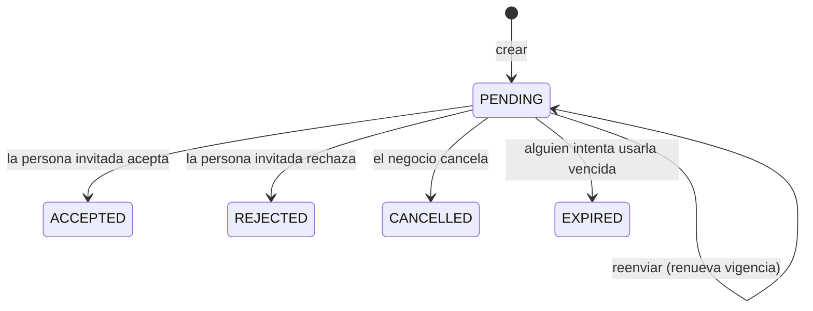
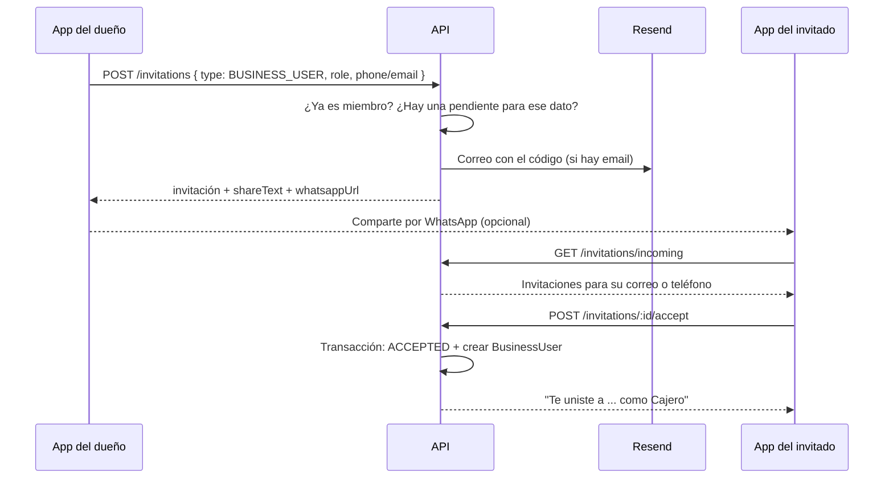

# Módulo `invitations`

**Código:** `src/invitations/`

> **Estado:** rediseño en `feature/invitations`, **sin revisar ni probar**. Este documento describe lo que hace el código; al final hay una lista de puntos para validar en las pruebas.

## Propósito

Permite a un negocio invitar a una persona a:

- **unirse a su equipo** (`BUSINESS_USER`) con un rol, o
- **ver sus cuentas como cliente** (`DEBTOR`), vinculando su cuenta de usuario con su registro de deudor.

La invitación va dirigida a un **correo o teléfono**. Le aparece en la app a quien tenga ese dato en su cuenta, y solo esa persona puede aceptarla. El código sirve para compartirla por fuera (correo, WhatsApp).

## Alcance

**Hace:**
- Crear, listar, reenviar y cancelar invitaciones (lado del negocio).
- Mostrar, aceptar y rechazar invitaciones (lado de la persona invitada).
- Enviar el correo de invitación, si la invitación tiene correo.
- Devolver un texto y un enlace de WhatsApp listos para que el negocio la comparta desde su teléfono.
- Al aceptar: crear la membresía (`BusinessUser`) o vincular el deudor (`Debtor.userId`).

**No hace:**
- Enviar SMS ni mensajes de WhatsApp: el negocio comparte el enlace desde su propio teléfono.
- Invitar como `OWNER`: la propiedad solo cambia por transferencia (`account-lifecycle`).
- Gestionar miembros ya existentes (cambiar rol, quitar): `business-user`.

## Modelos

| Modelo | Uso en este módulo |
| --- | --- |
| `Invitation` | La invitación: tipo, rol, destinatario (`email`/`phone`), código, vigencia, estado, quién la creó y quién la aceptó |
| `Business` | Nombre para los mensajes; debe estar activo para aceptar |
| `Debtor` | Para `DEBTOR`: el registro de cliente que se vincula |
| `BusinessUser` | Para `BUSINESS_USER`: la membresía que se crea al aceptar |
| `AuditLog` | Creación, cancelación, aceptación y rechazo (a través de `AuditService`) |

## Endpoints

Todos exigen `Authorization: Bearer <token>`.

### Lado del negocio

Exigen `x-business-id` y rol `OWNER` o `ADMIN` en ese negocio.

| Método | Ruta | Qué hace |
| --- | --- | --- |
| `POST` | `/api/invitations` | Crear una invitación. Máximo 30 por hora por negocio |
| `GET` | `/api/invitations?page&limit&status&type` | Listar las invitaciones del negocio, paginadas, de la más reciente a la más antigua |
| `POST` | `/api/invitations/:id/resend` | Reenviar una pendiente: renueva la vigencia a 7 días y vuelve a enviar el correo. El código no cambia. Cuenta para el límite de 30 por hora |
| `DELETE` | `/api/invitations/:id` | Cancelar una pendiente |
| `GET` | `/api/invitations/business/:businessId` | **Obsoleto.** Igual que `GET /api/invitations`; rechaza si `:businessId` no coincide con `x-business-id` |

### Lado de la persona invitada

| Método | Ruta | Qué hace |
| --- | --- | --- |
| `GET` | `/api/invitations/incoming` | Invitaciones pendientes y vigentes dirigidas al correo o teléfono de su cuenta, de negocios activos. Para mostrarlas al abrir la app |
| `GET` | `/api/invitations/:code` | Ver una invitación por su código. 10 por minuto |
| `POST` | `/api/invitations/accept` | Aceptar con el código (body `{ code }`). 10 por minuto |
| `POST` | `/api/invitations/:id/accept` | Aceptar una invitación de `incoming` |
| `POST` | `/api/invitations/:id/reject` | Rechazar |

### Crear: body

| Campo | `BUSINESS_USER` | `DEBTOR` |
| --- | --- | --- |
| `type` | Obligatorio | Obligatorio |
| `role` | Obligatorio: `ADMIN`, `CASHIER` o `VIEWER` | No se permite |
| `debtorId` | No se permite | Obligatorio |
| `email` / `phone` | Al menos uno | Opcionales: si no viene ninguno, se usa el teléfono del deudor |
| `expiresInDays` | 1 a 30 (por defecto 7) | 1 a 30 (por defecto 7) |

El correo y el teléfono se normalizan igual que en el registro de usuarios, para que coincidan con los de la cuenta.

### Crear: respuesta

```json
{
  "message": "Invitación creada",
  "invitation": { "id": "...", "type": "BUSINESS_USER", "role": "CASHIER", "status": "PENDING", "code": "K7M2PQ9XAB", "...": "..." },
  "emailSent": true,
  "shareText": "Hola, Tienda Ana te invita a unirte a su equipo en APPUNTAO como Cajero. ...",
  "whatsappUrl": "https://wa.me/573001234567?text=..."
}
```

- `emailSent` es `false` si la invitación no tiene correo o si el envío falló. Un fallo de envío **no anula** la invitación.
- `whatsappUrl` es `null` si la invitación no tiene teléfono.

### Qué ve cada lado

| | Negocio | Persona invitada |
| --- | --- | --- |
| Código | Sí, para compartirlo | No |
| Correo y teléfono destino | Sí | No |
| Negocio, deudor, quién la creó | Deudor y creador | Nombre del negocio, nombre del deudor y del creador |
| Quién aceptó y cuándo respondió | Sí | No |

## Estados



- **El vencimiento es perezoso.** Ninguna tarea programada marca las invitaciones como `EXPIRED`: se marcan cuando alguien intenta verla, aceptarla o rechazarla después de `expiresAt`. Mientras tanto siguen en `PENDING` con fecha pasada. `incoming` y la detección de duplicados filtran por `expiresAt`, así que no las muestran.
- `ACCEPTED`, `REJECTED`, `CANCELLED` y `EXPIRED` son finales. Al cerrarse se guarda `respondedAt`.

## Flujos

### Invitar a un empleado



1. Se rechaza si la persona ya es miembro del negocio (buscada por el correo o teléfono de la invitación) o si ya hay una invitación pendiente y vigente para ese dato (409 `INVITATION_ALREADY_PENDING`, con el `invitationId` para reenviarla).
2. Si la persona **no tiene cuenta**, la invitación la espera: al registrarse con ese correo o teléfono, le aparece en `incoming`.
3. Al aceptar, se valida que sea la destinataria, que la invitación siga pendiente y vigente, y que el negocio esté activo. En una transacción se marca `ACCEPTED` (solo si sigue `PENDING`, para que dos peticiones no la acepten a la vez) y se crea el `BusinessUser` con el rol de la invitación.

### Invitar a un cliente

1. El negocio indica el `debtorId`. El deudor debe ser de ese negocio, estar activo y **no estar vinculado** a ninguna cuenta.
2. Si no se envía correo ni teléfono, se usa el teléfono del deudor.
3. Al aceptar, en la transacción se vincula el deudor a la cuenta (`Debtor.userId`), solo si sigue sin vincular y activo. Desde ahí el negocio aparece en `clientBusinesses` del dashboard del usuario.

### Aceptar con código

Para quien recibió el código por fuera de la app. El código no distingue mayúsculas ni espacios o guiones. La persona igual debe ser la destinataria: un código reenviado o filtrado no le sirve a nadie más.

## Permisos y seguridad

- **Solo la persona invitada responde.** Para ver por código, aceptar o rechazar, el correo o el teléfono de la invitación deben coincidir con los de la cuenta. Si no, 403.
- **Código:** 10 caracteres de un alfabeto de 31 símbolos sin caracteres confundibles (sin `0/O`, `1/I/L`): unas 8 × 10^14 combinaciones. Además, ver y aceptar por código tienen límite de 10 por minuto.
- **Límite por negocio:** crear y reenviar comparten un límite de 30 por hora **por negocio** (por `x-business-id`), sin importar el dispositivo. Evita usar APPUNTAO para envíos masivos de correo, que dañarían la reputación del dominio de envío.
- Los límites viven en memoria de cada instancia (igual que el de login).

## Integraciones

| Con | Para qué |
| --- | --- |
| `providers/email.provider.ts` | Correos de invitación de cliente y de empleado (HTML y texto) |
| `audit` | `INVITATION_CREATED`, `INVITATION_CANCELLED`, `INVITATION_ACCEPTED`, `INVITATION_REJECTED` |
| `auth` | `JwtAuthGuard`, `BusinessContextGuard`, `BusinessRoleGuard` |

## Errores

| Código | Cuándo |
| --- | --- |
| 400 | Faltan datos según el tipo (`role`, `debtorId`, correo o teléfono); campos que no aplican al tipo; cliente inactivo; invitación vencida; negocio inactivo al aceptar |
| 403 | La invitación es para otro correo o teléfono; ruta obsoleta con un negocio distinto al activo |
| 404 | Negocio, cliente o invitación no encontrados; código inválido |
| 409 | Ya es miembro; cliente ya vinculado; invitación pendiente duplicada (`INVITATION_ALREADY_PENDING`); invitación ya respondida o cancelada; solo se reenvían pendientes |
| 429 | Límite de creación o de intentos con código superado |

## Migración

`20261021030257_invitations_redesign` agrega los estados `REJECTED` y `CANCELLED`, las columnas `createdById`, `acceptedById` y `respondedAt`, sus llaves foráneas (`ON DELETE SET NULL`) e índices por `(businessId, status)`, `(email, status)` y `(phone, status)`. Solo agrega: no modifica datos existentes. Requiere PostgreSQL 12 o superior.

Las invitaciones anteriores al rediseño quedan con `createdById` en `null` y pueden tener códigos en minúsculas; la búsqueda por código no distingue mayúsculas para seguir encontrándolas.

## Decisiones y pendientes

- **Decisión:** la invitación se dirige a un dato de contacto y solo esa persona puede aceptarla. **Por qué:** antes cualquiera con el código podía aceptarla.
- **Decisión:** `listByBusiness` (obsoleto) compara la ruta con el negocio activo. **Por qué:** antes permitía ver invitaciones de otros negocios.
- **Decisión:** compartir por WhatsApp con un enlace `wa.me`. **Por qué:** no requiere una integración paga; el negocio lo envía desde su teléfono.

### Puntos para validar en las pruebas

Detalles que salen de leer el código y que conviene confirmar al probar:

1. **Usuarios sin correo ni teléfono.** El registro permite crear una cuenta solo con documento. Esa persona nunca ve invitaciones en `incoming` ni puede aceptar ninguna, porque no hay dato con el cual coincidir. ¿Es lo esperado, o la app debe pedirle un correo o teléfono?
2. **Reenviar renueva siempre a 7 días**, aunque la invitación se hubiera creado con otro `expiresInDays`. También revive una invitación vencida que siga en `PENDING` (por el vencimiento perezoso). Reenviar **no queda en la auditoría**.
3. **El límite por negocio usa solo el header `x-business-id`.** Si el negocio llega por parámetro o query, todas esas peticiones comparten un mismo contador (`invitations:none`).
4. **Un usuario puede quedar vinculado a dos deudores del mismo negocio** si el negocio lo invita desde dos registros de cliente distintos. No hay validación que lo impida.
5. **La búsqueda por código no distingue mayúsculas** (`mode: 'insensitive'`), así que no usa el índice único de `code` y recorre la tabla. Con pocas invitaciones no importa; si la tabla crece, conviene normalizar los códigos viejos a mayúsculas y buscar por igualdad exacta.
6. **Concurrencia al aceptar:** probar dos aceptaciones simultáneas de la misma invitación. La segunda debe responder 409.
