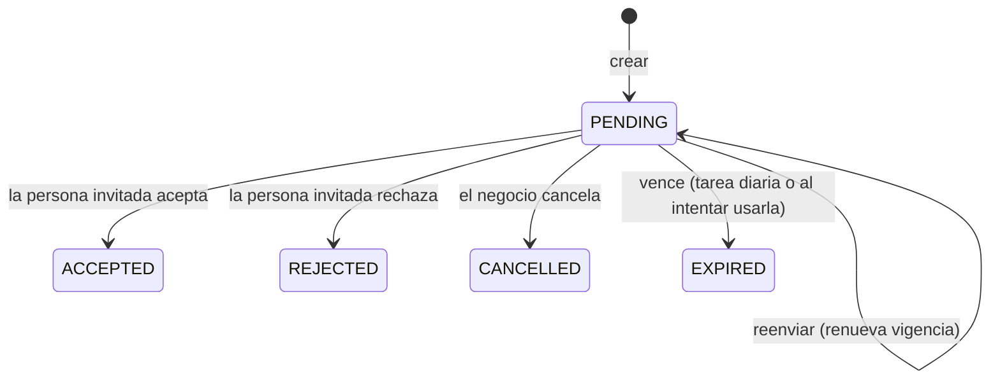
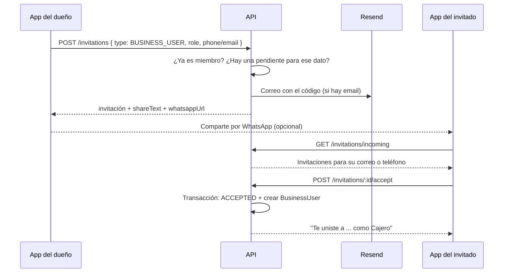

# Módulo `invitations`

**Código:** `src/invitations/`

> **Estado:** rediseño en `feature/invitations`, en el backend y en la app. El backend se probó por script el 2026-11-19, con 24 casos (ver [Qué se verificó](#qué-se-verificó)). Los flujos de equipo y de cliente se probaron desde la app el 2026-11-20. El 2026-11-21 se agregaron el permiso del cajero para invitar clientes y la desvinculación; eso falta probarlo.

## Propósito

Permite a un negocio invitar a una persona a:

- **unirse a su equipo** (`BUSINESS_USER`) con un rol, o
- **ver sus cuentas como cliente** (`DEBTOR`), vinculando su cuenta de usuario con su registro de deudor.

La invitación va dirigida a un **correo o teléfono**. Le aparece en la app a quien tenga ese dato en su cuenta, y solo esa persona puede aceptarla. El código sirve para compartirla por fuera (correo, WhatsApp).

**Es la única forma de vincular una cuenta con un cliente.** Antes, al registrarse, la cuenta se vinculaba sola con los clientes de **cualquier** negocio que tuvieran su mismo documento o teléfono. Eso dejaba que un negocio cualquiera "reclamara" a una persona registrando su número. Desde el commit `e24f320`, el vínculo solo se crea cuando la persona acepta una invitación `DEBTOR` del negocio. Los vínculos que ya existían se conservan.

## Alcance

**Hace:**
- Crear, listar, reenviar y cancelar invitaciones (lado del negocio).
- Mostrar, aceptar y rechazar invitaciones (lado de la persona invitada).
- Enviar el correo de invitación, si la invitación tiene correo.
- Devolver un texto y un enlace de WhatsApp listos para que el negocio la comparta desde su teléfono.
- Al aceptar: crear la membresía (`BusinessUser`) o vincular el deudor (`Debtor.userId`).
- Deshacer el vínculo de un cliente, desde el negocio o desde el cliente (rutas en `debtors`, ver [Desvincular un cliente](#desvincular-un-cliente)).

**No hace:**
- Enviar SMS ni mensajes de WhatsApp: el negocio comparte el enlace desde su propio teléfono.
- Invitar como `OWNER`: la propiedad solo cambia por transferencia (`account-lifecycle`).
- Gestionar miembros ya existentes (cambiar rol, quitar): `business-user`.

## Modelos

| Modelo | Uso en este módulo |
| --- | --- |
| `Invitation` | La invitación: tipo, rol, destinatario (`email`/`phone`), código, vigencia, estado, quién la creó y quién la aceptó |
| `Business` | Nombre para los mensajes; debe estar activo para aceptar |
| `Debtor` | Para `DEBTOR`: el registro de cliente que se vincula |
| `BusinessUser` | Para `BUSINESS_USER`: la membresía que se crea al aceptar |
| `AuditLog` | Creación, reenvío, cancelación, aceptación, rechazo y desvinculación (a través de `AuditService`) |

## Endpoints

Todos exigen `Authorization: Bearer <token>`.

### Lado del negocio

Exigen `x-business-id` y rol `OWNER`, `ADMIN` o `CASHIER` en ese negocio. **El cajero solo maneja invitaciones de clientes** (`DEBTOR`): si intenta crear, reenviar o cancelar una del equipo recibe 403, y al listar solo se le devuelven las de clientes. Es quien atiende a los clientes en el mostrador, pero no decide quién entra al equipo.

| Método | Ruta | Qué hace |
| --- | --- | --- |
| `POST` | `/api/invitations` | Crear una invitación. Máximo 30 por hora por negocio |
| `GET` | `/api/invitations?page&limit&status&type` | Listar las invitaciones del negocio, paginadas, de la más reciente a la más antigua |
| `POST` | `/api/invitations/:id/resend` | Reenviar una pendiente: renueva la vigencia a 7 días y vuelve a enviar el correo. El código no cambia. Cuenta para el límite de 30 por hora y queda en auditoría (`INVITATION_RESENT`) |
| `DELETE` | `/api/invitations/:id` | Cancelar una pendiente |
| `GET` | `/api/invitations/business/:businessId` | **Obsoleto.** Igual que `GET /api/invitations`; rechaza si `:businessId` no coincide con `x-business-id` |

### Lado de la persona invitada

| Método | Ruta | Qué hace |
| --- | --- | --- |
| `GET` | `/api/invitations/incoming` | Invitaciones pendientes y vigentes dirigidas al correo o teléfono de su cuenta, de negocios activos. Para mostrarlas al abrir la app |
| `GET` | `/api/invitations/:code` | Ver una invitación por su código. 10 por minuto |
| `POST` | `/api/invitations/accept` | Aceptar con el código (body `{ code }`). 10 por minuto |
| `POST` | `/api/invitations/:id/accept` | Aceptar una invitación de `incoming` |
| `POST` | `/api/invitations/:id/reject` | Rechazar |

### Crear: body

| Campo | `BUSINESS_USER` | `DEBTOR` |
| --- | --- | --- |
| `type` | Obligatorio | Obligatorio |
| `role` | Obligatorio: `ADMIN`, `CASHIER` o `VIEWER` | No se permite |
| `debtorId` | No se permite | Obligatorio |
| `email` / `phone` | Al menos uno | Opcionales: si no viene ninguno, se usa el teléfono del deudor |
| `expiresInDays` | 1 a 30 (por defecto 7) | 1 a 30 (por defecto 7) |

El correo y el teléfono se normalizan igual que en el registro de usuarios, para que coincidan con los de la cuenta.

### Crear: respuesta

```json
{
  "message": "Invitación creada",
  "invitation": { "id": "...", "type": "BUSINESS_USER", "role": "CASHIER", "status": "PENDING", "code": "K7M2PQ9XAB", "...": "..." },
  "emailSent": true,
  "shareText": "Hola, Tienda Ana te invita a unirte a su equipo en APPUNTAO como Cajero. ...",
  "whatsappUrl": "https://wa.me/573001234567?text=..."
}
```

- `emailSent` es `false` si la invitación no tiene correo o si el envío falló. Un fallo de envío **no anula** la invitación.
- `whatsappUrl` es `null` si la invitación no tiene teléfono.

### Qué ve cada lado

| | Negocio | Persona invitada |
| --- | --- | --- |
| Código | Sí, para compartirlo | No |
| Correo y teléfono destino | Sí | No |
| Negocio, deudor, quién la creó | Deudor y creador | Nombre del negocio, nombre del deudor y del creador |
| Quién aceptó y cuándo respondió | Sí | No |

## Estados



- **Vencimiento.** La tarea diaria de las 3:00 a. m. (`account-lifecycle`) marca como `EXPIRED` las pendientes con `expiresAt` pasado. Si alguien intenta usar una vencida antes de esa hora, también se marca en ese momento. Entre tanto, `incoming` y la detección de duplicados filtran por `expiresAt`, así que nunca muestran una vencida.
- `ACCEPTED`, `REJECTED`, `CANCELLED` y `EXPIRED` son finales. Al cerrarse se guarda `respondedAt`.

## Flujos

### Invitar a un empleado



1. Se rechaza si la persona ya es miembro del negocio (buscada por el correo o teléfono de la invitación) o si ya hay una invitación pendiente y vigente para ese dato (409 `INVITATION_ALREADY_PENDING`, con el `invitationId` para reenviarla).
2. Si la persona **no tiene cuenta**, la invitación la espera: al registrarse con ese correo o teléfono, le aparece en `incoming`.
3. Al aceptar, se valida que sea la destinataria, que la invitación siga pendiente y vigente, y que el negocio esté activo. En una transacción se marca `ACCEPTED` (solo si sigue `PENDING`, para que dos peticiones no la acepten a la vez) y se crea el `BusinessUser` con el rol de la invitación.

### Invitar a un cliente

1. El negocio indica el `debtorId`. El deudor debe ser de ese negocio, estar activo y **no estar vinculado** a ninguna cuenta.
2. Si no se envía correo ni teléfono, se usa el teléfono del deudor.
3. Al aceptar, en la transacción se vincula el deudor a la cuenta (`Debtor.userId`), solo si sigue sin vincular y activo. Desde ahí el negocio aparece en `clientBusinesses` del dashboard del usuario, y sus deudas se leen con `GET /api/debtors/me/:debtorId/debts`. Ese endpoint solo responde si la ficha está vinculada a su cuenta (404 si no), no pide `x-business-id` ni ser del equipo, y devuelve todas las deudas con sus pagos, sin paginar. Las rutas del tendero (`/debtors/:id/debts`) exigen ser miembro y le responden 403 a un cliente.
4. **Una cuenta es cliente una sola vez por negocio.** Si el negocio tiene dos registros de la misma persona y la invita desde los dos, la segunda aceptación responde 409 y la invitación sigue pendiente.

### Desvincular un cliente

El vínculo se puede deshacer por dos lados. En los dos casos la ficha, sus deudas y sus pagos no cambian: solo deja de estar ligada a la cuenta, y el negocio puede volver a invitarla.

| Método | Ruta | Quién | Qué hace |
| --- | --- | --- | --- |
| `PATCH` | `/api/debtors/:id/unlink` | `OWNER` o `ADMIN`, con `x-business-id` | El negocio desvincula la ficha, por ejemplo si aceptó la persona equivocada. 409 si no estaba vinculada |
| `DELETE` | `/api/debtors/me/:debtorId/link` | La cuenta vinculada | El cliente deja de ver la tienda en el modo cliente. 404 si la ficha no es suya |

Las dos quedan en auditoría como `DEBTOR_UNLINKED`, con `meta.by` en `BUSINESS` o `CLIENT`, el negocio y la cuenta que estaba vinculada (`previousUserId`). Al eliminar una cuenta, `account-lifecycle` también suelta sus fichas; eso queda registrado como parte de la eliminación.

### Aceptar con código

Para quien recibió el código por fuera de la app. El código no distingue mayúsculas ni espacios o guiones: se normaliza y se busca por el índice único. Solo si no aparece se busca sin distinguir mayúsculas, por las invitaciones viejas que tenían códigos en minúsculas. La persona igual debe ser la destinataria: un código reenviado o filtrado no le sirve a nadie más.

## Permisos y seguridad

- **Solo la persona invitada responde.** Para ver por código, aceptar o rechazar, el correo o el teléfono de la invitación deben coincidir con los de la cuenta. Si no, 403.
- **Código:** 10 caracteres de un alfabeto de 31 símbolos sin caracteres confundibles (sin `0/O`, `1/I/L`): unas 8 × 10^14 combinaciones. Además, ver y aceptar por código tienen límite de 10 por minuto.
- **Límite por negocio:** crear y reenviar comparten un límite de 30 por hora **por negocio**, sin importar el dispositivo. El negocio se toma igual que en `BusinessContextGuard`: del header `x-business-id`, de la ruta o del query. Evita usar APPUNTAO para envíos masivos de correo, que dañarían la reputación del dominio de envío.
- Los límites viven en memoria de cada instancia (igual que el de login).

## Integraciones

| Con | Para qué |
| --- | --- |
| `providers/email.provider.ts` | Correos de invitación de cliente y de empleado (HTML y texto) |
| `audit` | Ver [Auditoría](#auditoría) |
| `account-lifecycle` | La tarea diaria marca las vencidas. Al borrar un negocio cerrado se borran sus invitaciones |
| `auth` | `JwtAuthGuard`, `BusinessContextGuard`, `BusinessRoleGuard` |

## Auditoría

Toda acción de una persona queda en `AuditLog` con quien la hizo (`userId`), la invitación o la ficha (`entityId`) y el negocio en `meta.businessId`. Al purgar un negocio cerrado se borran por `entityId`.

| Acción | Cuándo | `meta` |
| --- | --- | --- |
| `INVITATION_CREATED` | Crear | `businessId`, `type`, `role`, `debtorId`, `actorRole` (para saber si invitó un cajero), `byEmail`, `byPhone` |
| `INVITATION_RESENT` | Reenviar | `businessId`, `type`, `emailSent` |
| `INVITATION_CANCELLED` | Cancelar | `businessId`, `type` |
| `INVITATION_ACCEPTED` | Aceptar | `businessId`, `type`, `role`, `debtorId`: la ficha que quedó vinculada |
| `INVITATION_REJECTED` | Rechazar | `businessId`, `type` |
| `DEBTOR_UNLINKED` | Desvincular (módulo `debtors`) | `businessId`, `previousUserId`, `by` (`BUSINESS` o `CLIENT`) |

**No se registra el vencimiento:** lo hace la tarea diaria, no una persona, y el estado `EXPIRED` queda en la invitación misma.

## Errores

| Código | Cuándo |
| --- | --- |
| 400 | Faltan datos según el tipo (`role`, `debtorId`, correo o teléfono); campos que no aplican al tipo; cliente inactivo; invitación vencida; negocio inactivo al aceptar |
| 403 | La invitación es para otro correo o teléfono; un cajero intenta crear, reenviar o cancelar una del equipo; ruta obsoleta con un negocio distinto al activo |
| 404 | Negocio, cliente o invitación no encontrados; código inválido |
| 409 | Ya es miembro; cliente ya vinculado; ya es cliente de ese negocio desde otro registro; invitación pendiente duplicada (`INVITATION_ALREADY_PENDING`); invitación ya respondida o cancelada; solo se reenvían pendientes |
| 429 | Límite de creación o de intentos con código superado |

## Migración

`20261021030257_invitations_redesign` agrega los estados `REJECTED` y `CANCELLED`, las columnas `createdById`, `acceptedById` y `respondedAt`, sus llaves foráneas (`ON DELETE SET NULL`) e índices por `(businessId, status)`, `(email, status)` y `(phone, status)`. Solo agrega: no modifica datos existentes. Requiere PostgreSQL 12 o superior.

Las invitaciones anteriores al rediseño quedan con `createdById` en `null` y pueden tener códigos en minúsculas; la búsqueda por código no distingue mayúsculas para seguir encontrándolas.

## Decisiones y pendientes

- **Decisión:** la invitación se dirige a un dato de contacto y solo esa persona puede aceptarla. **Por qué:** antes cualquiera con el código podía aceptarla.
- **Decisión:** `listByBusiness` (obsoleto) compara la ruta con el negocio activo. **Por qué:** antes permitía ver invitaciones de otros negocios.
- **Decisión:** compartir por WhatsApp con un enlace `wa.me`. **Por qué:** no requiere una integración paga; el negocio lo envía desde su teléfono.
- **Decisión (2026-11-21):** el cajero puede invitar clientes, pero no al equipo. **Por qué:** es quien registra a los clientes en el mostrador.
- **Decisión (2026-11-21):** el vínculo se puede deshacer desde el negocio (dueño o administrador) y desde el cliente. **Por qué:** si acepta la persona equivocada no había cómo corregirlo, y el cliente debe poder dejar de ver una tienda.

### Puntos de la revisión del 2026-11-19

| # | Punto | Resultado |
| --- | --- | --- |
| 1 | Cuentas sin correo ni teléfono no pueden recibir invitaciones | Sigue igual. El registro exige los dos desde este rediseño; solo afecta a cuentas viejas (ver [users.md](users.md#decisiones-y-pendientes)) |
| 2 | Reenviar renueva siempre a 7 días y revive una vencida | **Se deja así a propósito**: reenviar es lo que se hace cuando a alguien se le pasó el plazo. Ahora queda en auditoría (`INVITATION_RESENT`) |
| 3 | El límite por negocio contaba solo el header | **Corregido**: usa el mismo extractor que `BusinessContextGuard` |
| 4 | Una cuenta podía quedar vinculada a dos clientes del mismo negocio | **Corregido**: la segunda aceptación responde 409 |
| 5 | La búsqueda por código recorría la tabla | **Corregido**: busca por el índice único y solo después sin distinguir mayúsculas |
| 6 | Dos aceptaciones simultáneas | **Probado**: una pasa y la otra responde 409 |
| 7 | Las vencidas quedaban en `PENDING` | **Ya estaba resuelto**: la tarea diaria las marca `EXPIRED` |

### Qué se verificó

Script contra una base desechable con todas las migraciones aplicadas, en el mismo orden en que las recibe development:

- **Equipo:** sin rol responde 400; duplicado pendiente, 409; solo la destinataria la ve en `incoming`; otra cuenta con el código recibe 403; el código se encuentra con minúsculas, espacios y guiones; dos aceptaciones a la vez dejan una sola; ya miembro, 409.
- **Correo y reenvío:** sin correo no se envía; con correo sí; el enlace de WhatsApp lleva el 57; reenviar renueva la vigencia y queda auditado; reenviar una cancelada responde 409.
- **Clientes:** sin dato de contacto usa el teléfono del cliente; aceptar vincula el registro; un segundo registro del mismo negocio responde 409 y la transacción se revierte; invitar a un cliente ya vinculado responde 409.
- **Cierre:** rechazar deja `REJECTED`; aceptar una vencida responde 400 y la marca `EXPIRED`; las de un negocio cerrado no aparecen en `incoming`.

**En la app (2026-11-20):** invitar al equipo; invitar a un cliente con cuenta y con el mismo celular; cliente desde cero (registro con el número invitado); cuenta con otro celular (403 con el código, luego invitación por correo); rechazar y cancelar.

**Falta probar:** el cajero invitando clientes y la desvinculación por los dos lados.
