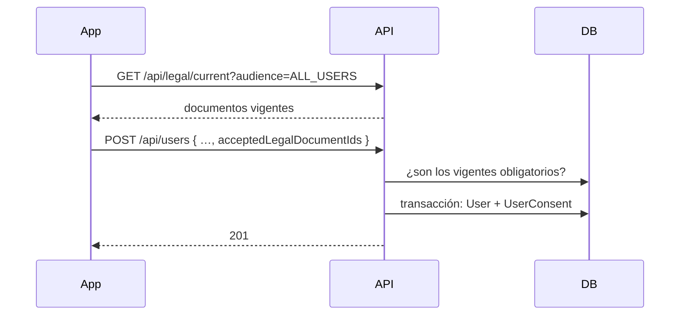

# Módulo `legal`

**Código:** `src/legal/` · **Script:** `scripts/publish-legal-document.js` · **Textos:** `legal/<tipo>/<version>.md`

## Propósito

Cumplir la **Ley 1581 de 2012** de protección de datos personales:

- Antes de registrarse, el usuario acepta la versión vigente de los documentos legales.
- Antes de crear un negocio, acepta el acuerdo que lo hace Responsable de los datos de sus clientes.
- Se conserva la prueba de cada aceptación: qué texto exacto, cuándo y desde dónde.

## Alcance

**Hace:**
- Mantiene el catálogo de tipos de documento y sus versiones publicadas.
- Sirve los documentos vigentes, filtrados por público.
- Exige la aceptación en el registro (`users`) y en la creación de negocios (`business`).
- Registra las aceptaciones y dice qué le falta aceptar a cada usuario.

**No hace:**
- **Bloquear** a un usuario con documentos pendientes. El backend los informa; es la app la que no deja seguir hasta aceptarlos.
- Editar textos ya publicados. Un cambio es siempre una versión nueva.
- Ofrecer una interfaz de administración. Los documentos se publican con el script y los tipos se agregan por SQL o Prisma Studio.

## Modelos

### `LegalDocumentKind`: catálogo de tipos

Cada fila es un tipo de documento. Un tipo nuevo es una fila más: no hace falta migración ni otra versión de la app, porque la app muestra lo que le llegue con su `title`.

| Campo | Tipo | Qué es |
| --- | --- | --- |
| `code` | `String`, PK | Código estable del tipo (`PRIVACY_POLICY`). Es lo que guarda `LegalDocument.type` y lo que usa la app en la ruta `/legal/<code>`. **No se cambia** una vez creado |
| `title` | `String` | Nombre que ve el usuario (`Política de Tratamiento de Datos Personales`) |
| `audience` | `LegalAudience` | A quién se le exige. Por defecto `ALL_USERS` |
| `required` | `Boolean` | `true`: obligatorio, bloquea el registro o la creación de negocios si no se acepta y queda pendiente si sale una versión nueva. `false`: consentimiento opcional, se puede aceptar pero nunca bloquea ni queda pendiente |
| `sortOrder` | `Int` | Orden en que se muestran (de menor a mayor) |
| `active` | `Boolean` | `false`: deja de servirse y de exigirse, sin borrar su historial |
| `createdAt`, `updatedAt` | `DateTime` | Auditoría de la fila |

**Tipos con los que se sale a producción** (sembrados por la migración `20261108120000_legal_document_kinds`):

| `code` | `audience` | Se acepta | Por qué |
| --- | --- | --- | --- |
| `TERMS_AND_CONDITIONS` | `ALL_USERS` | Al registrarse | El contrato de uso de la app (Ley 527 de 1999, Ley 1480 de 2011) |
| `PRIVACY_POLICY` | `ALL_USERS` | Al registrarse | Todo Responsable debe tener una política de tratamiento (Ley 1581 de 2012, Decreto 1074 de 2015) |
| `DATA_PROCESSING_AGREEMENT` | `BUSINESS_OWNERS` | Al crear un negocio | El tendero es Responsable de los datos de sus clientes (nombre, teléfono, cédula, deudas) y Appuntao los trata por cuenta suya como Encargado. La ley pide un contrato de transmisión (Decreto 1074 de 2015, art. 2.2.2.25.5.2) |

### `LegalDocument`: versiones publicadas

Cada fila es una versión de un tipo. La **vigente** de cada tipo es la de `publishedAt` más reciente que ya se cumplió, así que se puede publicar con fecha futura.

| Campo | Tipo | Qué es |
| --- | --- | --- |
| `id` | `String` (UUID), PK | Lo que la app envía en `acceptedLegalDocumentIds` y en `documentIds` |
| `type` | `String`, FK → `LegalDocumentKind.code` | Tipo del documento |
| `version` | `String` | Nombre de la versión (`2026-10`). Único por tipo: `@@unique([type, version])` |
| `content` | `String` | Texto completo en Markdown, tal como se muestra |
| `contentHash` | `String` | SHA-256 de `content`, con saltos de línea normalizados a `\n`. Es la prueba de qué texto exacto se aceptó |
| `url` | `String?` | Página pública donde también está publicado, si existe |
| `publishedAt` | `DateTime` | Desde cuándo rige |
| `createdAt` | `DateTime` | Cuándo se cargó |

Índice `[type, publishedAt]`: es la consulta de "vigente por tipo".

**Una versión publicada no se modifica.** El script se niega a publicar otro texto con un `version` que ya existe, porque cambiarlo invalidaría la prueba de quienes ya lo aceptaron.

### `UserConsent`: aceptaciones

Cada fila es la prueba de que un usuario aceptó una versión. Solo se agregan filas.

| Campo | Tipo | Qué es |
| --- | --- | --- |
| `id` | `String` (UUID), PK | |
| `userId` | `String`, FK → `User` | Quién aceptó |
| `documentId` | `String`, FK → `LegalDocument` | Qué versión aceptó |
| `acceptedAt` | `DateTime` | Cuándo |
| `ipAddress` | `String?` | Desde qué IP |
| `userAgent` | `String?` | Con qué app o navegador |

- `@@unique([userId, documentId])`: aceptar dos veces la misma versión no duplica la fila (`skipDuplicates`).
- Las llaves foráneas son `RESTRICT`: no se puede borrar un usuario ni un documento que tenga aceptaciones.

### Enum `LegalAudience`

| Valor | A quién se le exige | Cuándo |
| --- | --- | --- |
| `ALL_USERS` | Todo usuario | En el registro (`POST /api/users`) y, si sale una versión nueva, al entrar |
| `BUSINESS_OWNERS` | Quien crea o tiene un negocio activo | Al crear un negocio (`POST /api/business`) y, si sale una versión nueva, al entrar |

## Endpoints

| Método | Ruta | Acceso | Qué hace |
| --- | --- | --- | --- |
| `GET` | `/api/legal/current` | Público | Versión vigente de cada tipo activo, en su orden, con texto. `?audience=ALL_USERS` o `?audience=BUSINESS_OWNERS` filtra por público |
| `GET` | `/api/legal/pending` | Autenticado | Obligatorios vigentes que el usuario no ha aceptado. Los de `BUSINESS_OWNERS` solo si tiene un negocio activo |
| `POST` | `/api/legal/accept` | Autenticado | Body `{ documentIds }`. Registra la aceptación y devuelve lo que siga pendiente |

Cada documento se devuelve así:

```json
{
  "id": "6b1f3c2e-…",
  "type": "PRIVACY_POLICY",
  "version": "2026-10",
  "title": "Política de Tratamiento de Datos Personales",
  "audience": "ALL_USERS",
  "required": true,
  "content": "# Política…",
  "contentHash": "…",
  "url": null,
  "publishedAt": "2026-10-16T00:00:00.000Z"
}
```

Login y refresh devuelven además `pendingLegalDocuments` (`id`, `type`, `version`, `title`).

## Reglas de negocio

- **Registro** (`POST /api/users`): `acceptedLegalDocumentIds` debe traer la versión vigente de **todos** los obligatorios de `ALL_USERS`. Puede incluir opcionales de ese público; un id de otro público o de una versión vieja se rechaza.
- **Creación de negocio** (`POST /api/business`): lo mismo con `BUSINESS_OWNERS`. Lo que el usuario ya había aceptado no hace falta reenviarlo, por ejemplo al crear su segundo negocio.
- En los dos casos, la entidad y sus aceptaciones se guardan en la misma transacción: no puede existir una cuenta o un negocio sin la prueba de la aceptación.
- Un tipo obligatorio y activo **sin ninguna versión publicada** bloquea ese momento con 503. Un tipo inactivo no se exige.
- Publicar una versión nueva de un obligatorio la deja pendiente para todos los que aceptaron la anterior.

## Flujos

### Registro



Si se publicó una versión nueva mientras el usuario llenaba el formulario, el registro responde 400. La app vuelve a pedir los documentos y le pide aceptarlos otra vez.

### Crear un negocio

Igual que el registro, con `?audience=BUSINESS_OWNERS` y `POST /api/business`.

### Versión nueva con sesión iniciada

1. Se publica la versión con el script.
2. Al entrar, la app consulta `GET /api/legal/pending`, o lee `pendingLegalDocuments` del login.
3. Si hay pendientes, muestra la pantalla de aceptación y llama `POST /api/legal/accept`.

### Publicar una versión

Los textos se guardan en el repositorio, en `legal/<tipo>/<version>.md` (`legal/terms-and-conditions/`, `legal/privacy-policy/`, `legal/data-processing-agreement/`):

```bash
npm run legal:publish:local -- --type PRIVACY_POLICY --version 2026-10 --file legal/privacy-policy/2026-10.md
npm run legal:publish:local -- --list
```

| Opción | Qué es |
| --- | --- |
| `--type` | Un `code` del catálogo |
| `--version` | Nombre de la versión |
| `--file` | Ruta del Markdown |
| `--url` (opcional) | Página pública donde también está publicado |
| `--published-at` (opcional) | Desde cuándo rige. Por defecto, ahora |
| `--list` | Muestra los tipos del catálogo |

El mismo comando existe para `development` y `production` (`legal:publish:development`, `legal:publish:production`). Publicar dos veces la misma versión con el mismo texto no hace nada; con un texto distinto, falla.

### Agregar un tipo

1. Inserta la fila en `LegalDocumentKind`, por SQL o Prisma Studio.
2. Publica su primera versión **en seguida**: un tipo obligatorio y activo sin versión bloquea su momento con 503.

No hace falta tocar la app: la app no tiene lista de tipos.

## Integraciones

| Con | Para qué |
| --- | --- |
| `users` | `assertAcceptsCurrent(ids, ALL_USERS)` y `recordConsents` al registrar |
| `business` | `assertAcceptsCurrent(ids, BUSINESS_OWNERS, userId)` y `recordConsents` al crear un negocio |
| `auth` | `pendingLegalDocuments` en login y refresh |

## Errores

| Código | Cuándo |
| --- | --- |
| 400 | Falta aceptar un obligatorio, o un id no es de la versión vigente, o es de otro público |
| 400 | `audience` inválido en `GET /current`, o `documentIds` vacío o con un id que no es UUID |
| 503 | Un tipo obligatorio y activo del público no tiene ninguna versión publicada |

## Despliegue

En un entorno nuevo, o al desplegar la migración del catálogo, publica **los tres documentos justo después de la migración**. Mientras falten, el registro y la creación de negocios responden 503.

## Decisiones y pendientes

- **Decisión:** catálogo en base de datos en lugar de un enum. **Por qué:** con un enum, la app necesitaba conocer la lista de tipos. Cuando el backend agregaba uno, la app vieja enviaba menos ids de los exigidos y el registro fallaba.
- **Decisión:** el backend no bloquea a quien tiene pendientes. **Por qué:** bloquear en el backend rompería todas las pantallas a la vez; la app ya muestra la pantalla de aceptación.
- **Decisión:** el acuerdo de transmisión es un documento aparte y solo para quien tiene negocio. **Por qué:** un cliente que solo consulta lo que debe no es Responsable de datos de nadie.
- **Pendiente:** los textos definitivos de los tres documentos, revisados por un abogado. El acuerdo debe cubrir el uso de los recordatorios de cobro por WhatsApp.
- **Pendiente:** retirar un consentimiento opcional. Hoy no hay endpoint para eso.
